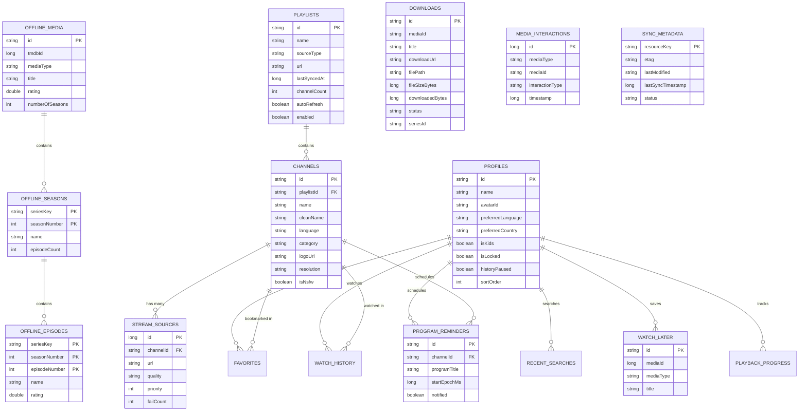

# NisTV Revamped — Project Specification & Architecture Reference

> **Generated Specification**  
> **Repository Root:** `/data/data/com.termux/files/home/NisTV-Revamped`  
> **Current App Version:** `2.0.3` (VersionCode: `20003`)  
> **Status:** Verified from source code, unit test execution, and release assembly.  
> **Last Updated:** November 26, 2026  
> **Notice:** All facts, paths, schema definitions, and versions herein reflect the exact state of the codebase as of November 2026.

---

## Table of Contents
1. [Overview](#1-overview)
2. [Tech Stack](#2-tech-stack)
3. [Architecture](#3-architecture)
4. [Features](#4-features)
5. [Screens, Pages, and Navigation Routes](#5-screens-pages-and-navigation-routes)
6. [Data Model & Persistence](#6-data-model--persistence)
7. [API & External Services](#7-api--external-services)
8. [AI & Intelligent Systems](#8-ai--intelligent-systems)
9. [Authentication, Authorization & Permissions](#9-authentication-authorization--permissions)
10. [Environment, Build & Deployment Configuration](#10-environment-build--deployment-configuration)
11. [Design System & UI Components](#11-design-system--ui-components)
12. [Testing, Verification & Quality Assurance](#12-testing-verification--quality-assurance)
13. [Known Issues, Technical Debt & Security Considerations](#13-known-issues-technical-debt--security-considerations)
14. [Codebase Conventions & Architectural Standards](#14-codebase-conventions--architectural-standards)
15. [Extension Points & Modularity Guide](#15-extension-points--modularity-guide)
16. [Offline Downloads Architecture & Pre-v6 Compatibility](#16-offline-downloads-architecture--pre-v6-compatibility)
17. [Versioning System](#17-versioning-system)
18. [Website & App Distribution Architecture](#18-website--app-distribution-architecture)

---

## 1. Overview

### 1.1 Application Summary
**NisTV Revamped** is a native Android entertainment application designed for streaming Live IPTV channels and Video-on-Demand (VOD) media (Movies and TV Series), accompanied by an offline multi-threaded download manager, an on-device content recommendation engine, electronic program guide (EPG) scheduling, and an offline video player with external subtitle decoding, gesture controls, and sleep timer automation.

### 1.2 Target Audience & Localization
- **Primary Market:** Viewers of Indian regional entertainment (supporting Hindi, Tamil, Telugu, Malayalam, Kannada, Bengali, Marathi, Punjabi, Gujarati, Bhojpuri, etc.) alongside global international programming.
- **Language Selection:** First-launch interactive language onboarding (`LanguageOnboardingDialog`) customizes the default Live TV channels, EPG scheduling, and Discover catalog.

### 1.3 Core Value Proposition
- **Unified Entertainment Hub:** Combines global/regional Live IPTV broadcasts with TMDB-indexed VOD metadata.
- **Zero-Friction Playback with Auto-Failover:** ExoPlayer playback engine with multi-source fallback cascades to alternate stream URLs when primary streams fail or return HTTP 4xx/5xx errors.
- **Resilient Media Downloading:** High-speed chunked downloader integrated with HashHackers AFDS archive search and direct URL resolution, featuring automatic link regeneration on resume, storage tracking, and Wi-Fi-only policies.
- **Continue Watching & Offline Experience:** Smart continuation on Home for partially watched downloads (between 5% and 95%), series episode collapsing, sidecar and imported subtitle parsing (UTF-8, UTF-16, Windows-1252), double-tap seek, vertical swipe brightness/volume gestures, speed control, autoplay next episode, and fade-to-pause sleep timer.
- **Privacy-Preserving On-Device Intelligence:** Adaptive content-based recommendation engine running locally on device via exponential time-decay vector affinity—no user interaction logs are shipped to remote AI/tracking servers.
- **Picture-in-Picture & Background Media:** Native Android O+ Picture-in-Picture (PiP), Android S+ auto-PiP, and foreground audio playback with Android MediaSession integration.

### 1.4 Maturity Level
- **Status:** **Production-Ready / Feature-Complete MVP**.
- The core playback pipeline, database migrations (v1 through v8 across 16 Room tables and 14 DAOs), network sync worker, download background service, auth gating with native AFDS sign-up and Google-to-email OTP fallback, Continue Watching rail, custom M3U playlists, TV Guide virtualized grid, program reminders, stream diagnostics HUD, hardware-backed Android KeyStore AES-256 GCM token encryption (`SecureTokenStore`), parental controls with PBKDF2 PIN and biometric fallback, portable transactional backup and restore, history and privacy controls, static and dynamic launcher shortcuts, startup sound controls, and comprehensive unit test coverage (34 test suites, all passing) are fully implemented and verified.

---

## 2. Tech Stack

### 2.1 Core Runtime & Tooling
| Component | Tool / Runtime | Version | Manifest / Reference |
| :--- | :--- | :--- | :--- |
| **Operating System Target** | Android | Compile SDK 35, Target SDK 34, Min SDK 24 | `app/build.gradle.kts` |
| **Programming Language** | Kotlin | `2.0.21` | `gradle/libs.versions.toml` |
| **Build System** | Gradle (AGP) | `8.7.3` | `gradle/libs.versions.toml` |
| **Kotlin Compiler Plugin** | Jetpack Compose Compiler | `2.0.21` | `gradle/libs.versions.toml` |
| **Annotation Processing** | KSP (Kotlin Symbol Processing) | `2.0.21-1.0.28` | `gradle/libs.versions.toml` |
| **JVM Compatibility Target** | Java SE 17 | `JavaVersion.VERSION_17` | `app/build.gradle.kts` |

### 2.2 Frameworks & Libraries
| Library / Framework | Artifact Group & Module | Version | Purpose |
| :--- | :--- | :--- | :--- |
| **Compose BOM** | `androidx.compose:compose-bom` | `2024.12.01` | Declarative UI framework |
| **Material 3** | `androidx.compose.material3:material3` | (from BOM) | Modern UI components & styling |
| **Navigation Compose** | `androidx.navigation:navigation-compose` | `2.8.5` | Type-safe single-activity navigation |
| **Media3 ExoPlayer** | `androidx.media3:media3-exoplayer` | `1.5.1` | Core media player engine |
| **Media3 HLS** | `androidx.media3:media3-exoplayer-hls` | `1.5.1` | HLS (`.m3u8`) adaptive streaming |
| **Media3 DASH** | `androidx.media3:media3-exoplayer-dash` | `1.5.1` | Dynamic Adaptive Streaming over HTTP |
| **Media3 RTSP** | `androidx.media3:media3-exoplayer-rtsp` | `1.5.1` | Real-Time Streaming Protocol |
| **Media3 SmoothStreaming** | `androidx.media3:media3-exoplayer-smoothstreaming` | `1.5.1` | Microsoft SmoothStreaming format |
| **Media3 UI & Session** | `androidx.media3:media3-ui`, `media3-session` | `1.5.1` | MediaSession, notification & player UI |
| **Media3 OkHttp** | `androidx.media3:media3-datasource-okhttp` | `1.5.1` | Network data source with custom headers |
| **Room Database** | `androidx.room:room-runtime`, `room-ktx` | `2.6.1` | SQLite object relational mapping |
| **DataStore Preferences** | `androidx.datastore:datastore-preferences` | `1.1.1` | Key-value reactive preferences storage |
| **WorkManager** | `androidx.work:work-runtime-ktx` | `2.10.0` | Background periodic catalogue sync |
| **HTTP Client** | `com.squareup.okhttp3:okhttp` | `4.12.0` | Networking engine & connection pooling |
| **HTTP Logging** | `com.squareup.okhttp3:logging-interceptor` | `4.12.0` | Network request diagnostics |
| **Image Loading** | `io.coil-kt.coil3:coil-compose`, `coil-network-okhttp` | `3.0.4` | Async image caching & rendering |
| **Serialization** | `org.jetbrains.kotlinx:kotlinx-serialization-json`| `1.7.3` | JSON parsing & DTO serialization |
| **Coroutines** | `org.jetbrains.kotlinx:kotlinx-coroutines-android` | `1.9.0` | Asynchronous structured concurrency |
| **Google Play Auth** | `com.google.android.gms:play-services-auth` | `21.2.0` | Google Account sign-in |
| **Credential Manager** | `androidx.credentials:credentials` | `1.3.0` | Modern Android unified authentication |
| **Play Services Auth Bridge**| `androidx.credentials:credentials-play-services-auth`| `1.3.0` | Google ID credential provider |
| **Google Identity** | `com.google.android.libraries.identity.googleid:googleid`| `1.1.1` | ID Token extraction & handling |

### 2.3 Third-Party Services & Remote APIs
1. **The Movie Database (TMDB) API v3** (`https://api.themoviedb.org/3`): Remote movies/TV discovery, genres, recommendations, cast, posters, backdrops, and trailers.
2. **HashHackers AFDS Cloud Archive** (`https://tga-hd.api.hashhackers.com` & fallback reverse proxy `https://afds.hashhackers.com/proxyapi`): File indexing, cloud archive search, direct download URL generation (`/genLink`), user profile & daily quota tracking, authentication via Telegram/Email OTP, in-app sign-up registration (`/api/request-verification`, `/api/verify`), and Google ID token exchange (`/auth/google`).
3. **iptv-org API** (`https://iptv-org.github.io/api/`): Open-source catalogue of broadcast channels, streams, logos, categories, languages, and blocklists.
4. **Google Identity Verification** (`https://oauth2.googleapis.com/tokeninfo`, `https://www.googleapis.com/oauth2/v3/userinfo`): Google ID token signature verification and profile sync.
5. **NisTV Remote Release & Update Server** (`https://nistv.xi11a.eu.org/version.json` & `/api/version.json`): App version inspection, dynamic release changelog delivery, and direct APK download distribution.
6. **UI Avatars** (`https://ui-avatars.com/api/`): Dynamic monogram avatar generation for user profiles.

---

## 3. Architecture

### 3.1 High-Level Architecture Overview
NisTV Revamped employs clean MVVM (Model-View-ViewModel) and unidirectional data flow (UDF) powered by Kotlin Coroutines and StateFlow.

```mermaid
flowchart TD
    subgraph UI ["Presentation Layer (Jetpack Compose)"]
        Nav[NisTvAppNav / NavHost]
        Screens[Screens: Home, LiveTv, Discover, Details, Player, Downloads, Search, Favorites, Profile]
        Components[Design System Components & NisMiniPlayer]
        VMs[ViewModels: StateFlow UiState]
    end

    subgraph Core ["Core & Services"]
        AppCont[DefaultAppContainer (Manual DI)]
        PlayCtrl[PlayerController (ExoPlayer + Failover)]
        DlMgr[DownloadManager + ForegroundService]
        NetMon[NetworkMonitor]
        AuthMgr[GoogleAuthManager + AfdsAuthService]
    end

    subgraph Data ["Data & Repositories"]
        ChanRepo[ChannelRepository]
        TmdbRepo[TmdbRepository]
        WatchLaterRepo[WatchLaterRepository]
        RecEngine[IntelligentRecommendationEngine]
        EpgMgr[EpgManager]
        SyncWorker[CatalogueSyncWorker]
    end

    subgraph Storage ["Local Persistence & Network"]
        RoomDB[(Room Database v8: 16 Tables (14 DAOs))]
        DataStore[(DataStore Preferences)]
        Assets[(Assets: Seed Channels & EPG)]
        ExtAPIs[Remote APIs: TMDB, AFDS, iptv-org, Google OAuth]
    end

    Screens --> VMs
    VMs --> ChanRepo
    VMs --> TmdbRepo
    VMs --> WatchLaterRepo
    VMs --> DlMgr
    VMs --> PlayCtrl
    VMs --> RecEngine

    ChanRepo --> RoomDB
    ChanRepo --> Assets
    TmdbRepo --> ExtAPIs
    DlMgr --> RoomDB
    DlMgr --> ExtAPIs
    RecEngine --> RoomDB
    RecEngine --> TmdbRepo
    PlayCtrl --> ExtAPIs
    SyncWorker --> ExtAPIs
    SyncWorker --> RoomDB
    AppCont --> DataStore
    AppCont --> RoomDB
```

### 3.2 Directory Tree & Module Breakdown

```
NisTV-Revamped/
├── .env.example                               # Sample environment variable template (TMDB_API_KEY, DEFAULT_REGION)
├── build.gradle.kts                           # Top-level Gradle build configuration
├── gradle.properties                          # JVM memory, AndroidX, and build configuration
├── local.properties                           # Local SDK path and local TMDB_API_KEY override
├── settings.gradle.kts                        # Plugin repository declarations and project definitions
├── version.properties                         # Deterministic semantic versioning source of truth
├── CHANGELOG.md                               # Comprehensive version-by-version release history
├── gradle/
│   ├── libs.versions.toml                     # Version catalog declaring all dependencies and plugins
│   └── wrapper/                               # Gradle wrapper binaries and properties
├── assets/                                    # SVG branding, logos, and raster icon assets
├── website/                                   # Official landing website & APK distribution portal
│   ├── index.html                             # Single-page web application entry point
│   ├── download.html                          # Auto-download landing route with step-by-step install guide
│   ├── package.json                           # Vite, React 18, TypeScript, Tailwind CSS, Lucide icons
│   ├── src/
│   │   ├── data/appData.ts                    # Web release data, changelog, and specs
│   │   └── components/                        # Feature cards, Hero, Cast demo, FAQ, and Download sections
│   ├── public/                                # Public web server root
│   │   ├── downloads/                         # Production APK binaries (nistv-v1.6.2.apk, nistv-latest.apk)
│   │   ├── version.json                       # Android client update feed endpoint
│   │   └── api/version.json                   # Mirrored update API endpoint
│   └── dist/                                  # Compiled static production bundle
└── app/
    ├── build.gradle.kts                       # Android application module build setup & dependencies
    ├── proguard-rules.pro                     # Proguard rules for Room, Media3, Serialization, and OkHttp
    └── src/
        ├── test/java/com/nis/nistv/           # Comprehensive unit test suites (21 verified suites)
        │   ├── AfdsAuthServiceTest.kt         # AFDS DTO serialization, inviteCode encoding & email normalization
        │   ├── ChannelModelTest.kt            # Validates channel entity creation and relationships
        │   ├── DatabaseMigrationV6Test.kt     # Validates schema migrations (3->4, 4->5, 5->6) and offline DDL
        │   ├── DownloadModelTest.kt           # Validates download calculations, sizing, and candidates
        │   ├── DownloadsGroupingTest.kt       # Pure-function grouping of completed downloads (Movies vs TV)
        │   ├── DownloadsRepairAndGroupingTest.kt # Filename parser regexes, SeriesKeyHelper, and auto-repair
        │   ├── GoogleAuthTest.kt              # Validates client ID allowlists and token parsing
        │   ├── MediaDetailsRouteTest.kt       # Route creation, origin parameters, and URI encoding
        │   ├── MediaPreviewStoreTest.kt       # In-memory thread-safe LRU cache operations and eviction
        │   ├── OfflineMediaRepositoryTest.kt  # Validates offline metadata persistence and cascading asset deletions
        │   ├── PlayerOrientationTest.kt       # Target orientation resolution from sensors & auto-rotate states
        │   ├── RecommendationEngineTest.kt    # Validates vector affinity, decay, and scoring algorithms
        │   ├── SearchViewModelTest.kt         # Validates unified search filtering and multi-type counters
        │   ├── SeedValidationTest.kt          # Validates bundled seed JSON schema and channel IDs
        │   ├── SharedKeysTest.kt              # Shared element transition key uniqueness across roles and types
        │   ├── SplashTimelineTest.kt          # Validates timeline progress, easing bounds, and readiness math
        │   ├── StartupTest.kt                 # Verifies critical classloading for app lifecycle
        │   ├── StreamClassifierTest.kt        # Validates HTTP error handling and failover messages
        │   ├── TmdbModelTest.kt               # Validates TMDB DTO deserialization and domain mappings
        │   ├── VersioningTest.kt              # Validates semantic versioning consistency and code calculations
        │   └── WatchLaterTest.kt              # Validates Watch Later persistence and DTO conversions
        └── main/
            ├── AndroidManifest.xml            # App manifest: permissions, services, activities, FileProvider
            ├── assets/
            │   ├── epg/epg_data.json          # Bundled EPG program mapping schedule
            │   └── seed/channels_seed.json    # Bundled verified seed channels for instant offline start
            ├── res/                           # Android drawables, mipmaps, strings, XML file paths, splash audio
            └── java/com/nis/nistv/
                ├── NisTvApplication.kt       # Application class, uncaught crash logger, AppContainer DI
                ├── MainActivity.kt           # Entry activity, NavHost, PiP controller, auth gating dialogs
                ├── core/
                │   ├── auth/                  # Google OAuth & Credential Manager authentication bridge
                │   │   └── GoogleAuthManager.kt
                │   ├── database/              # Room database, version migrations, entities, DAOs
                │   │   ├── NisTvDatabase.kt   # Database definition (version 11, migrations 3->4, 4->5, 5->6, 6->7, 7->8, 8->9, 9->10, 10->11)
                │   │   ├── dao/               # 19 DAOs for channels, downloads, favorites, history, offline, playlists, reminders, subtitles, tracked series, autopilot rules, stream health, data usage, playback progress
                │   │   ├── entity/            # 21 Room entity data classes
                │   │   └── model/             # Relation models (ChannelWithStreams)
                │   ├── designsystem/          # Material 3 dark design tokens, icons, and reusable components
                │   │   ├── component/         # NisButton, NisChannelCard, AfdsAuthGateDialog, ChangelogDialog, AppUpdateDialog
                │   │   ├── icon/              # NisIcons: comprehensive vector icon catalog
                │   │   ├── theme/             # Color tokens, typography, shape, spacing, NisTvTheme
                │   │   └── transition/        # Shared element transitions, bounds, and content motion
                │   ├── navigation/            # Navigation routes, Screen sealed class, NisBottomNavigationBar
                │   │   └── NisNavigation.kt
                │   ├── network/               # Reactive connectivity state monitor
                │   │   └── NetworkMonitor.kt
                │   └── preferences/           # DataStore Preferences wrapper (auth, daily quotas, settings)
                │       └── UserPreferences.kt
                ├── data/
                │   ├── download/              # Download engine, providers, and foreground service
                │   │   ├── engine/            # DownloadManager, DownloadForegroundService, StorageStats, repair
                │   │   └── provider/          # DownloadProvider, AfdsDownloadProvider, AfdsAuthService, GenericUrl
                │   ├── epg/                   # Electronic Programme Guide loader & dynamic generator
                │   │   └── EpgManager.kt
                │   ├── model/                 # Domain models (Channel, StreamSource, SeedChannelDto)
                │   ├── recommendation/        # On-device intelligent recommendation engine & taste profile
                │   │   ├── IntelligentRecommendationEngine.kt
                │   │   ├── RecommendationModels.kt
                │   │   └── UserTasteProfile.kt
                │   ├── remote/                # iptv-org streaming API client with ETag HTTP caching
                │   │   └── IptvApi.kt
                │   ├── repository/            # ChannelRepository, WatchLaterRepository, OfflineMediaRepository
                │   │   ├── ChannelRepository.kt
                │   │   ├── OfflineMediaRepository.kt
                │   │   └── WatchLaterRepository.kt
                │   ├── seed/                  # JSON seed parser importing channels on cold start
                │   │   └── SeedImporter.kt
                │   ├── sync/                  # WorkManager background periodic catalogue synchronization
                │   │   └── CatalogueSyncWorker.kt
                │   └── tmdb/                  # The Movie Database remote API, models, and repository
                │       ├── model/             # TMDB DTOs, domain models, LanguageUtils
                │       ├── remote/            # TmdbApi (OkHttp client with 429 exponential backoff)
                │       └── repository/        # TmdbRepository (cached paged queries)
                ├── feature/                   # Feature presentation screens and ViewModels
                │   ├── details/               # Movie/TV series details, cast, similar, stream resolution
                │   ├── discover/              # VOD exploration by genre, language, trending, popular
                │   ├── downloads/             # Offline downloads manager, storage stats, offline player, grouping
                │   ├── favorites/             # User's bookmarked Live TV channels & Watch Later list
                │   ├── home/                  # Unified home dashboard: recommendations, channels, VOD
                │   ├── livetv/                # Category & language channel grid, search, favorites toggle
                │   ├── player/                # Fullscreen ExoPlayer, tracks, aspect ratio, stream selector, cast
                │   ├── profile/               # Account credentials, quota tracker, TMDB key, settings, AppUpdateChecker
                │   ├── search/                # Unified search across Live TV, Movies, and TV series
                │   └── splash/                # Animated brand launch splash screen & sonic identity
                └── playback/                  # Media3 ExoPlayer wrapper, failover engine, MediaSession
                    ├── PlaybackService.kt     # Foreground MediaSessionService for background playback
                    ├── PlaybackState.kt       # PlayerUiState, AspectRatioMode, PlaybackStatus
                    └── PlayerController.kt    # Multi-stream automatic failover controller
```

### 3.3 Dependency Injection Strategy
The project avoids heavy reflection or code generation frameworks (such as Dagger or Hilt) and instead uses an **Application-scoped Manual Dependency Injection Container** defined in `NisTvApplication.kt`:
- **`AppContainer` Interface**: Defines read-only properties for all singleton dependencies (`NisTvDatabase`, `ChannelRepository`, `PlayerController`, `UserPreferences`, `EpgManager`, `GoogleAuthManager`, `OkHttpClient`, `TmdbApi`, `TmdbRepository`, `DownloadManager`, `AfdsDownloadProvider`, `AfdsAuthService`, `GenericUrlDownloadProvider`, `IntelligentRecommendationEngine`, `NetworkMonitor`, `WatchLaterRepository`).
- **`DefaultAppContainer` Implementation**: Instantiates singletons lazily (`by lazy`), ensuring fast startup times and deterministic lifecycle management.
- ViewModels access dependencies directly via `(LocalContext.current.applicationContext as NisTvApplication).container` or custom `ViewModelProvider.Factory` instances.

### 3.4 State Management Pattern
- Every feature screen adheres strictly to **Unidirectional Data Flow (UDF)**.
- **ViewModels** expose an immutable `StateFlow<UiState>` to the Compose layer.
- User interactions trigger explicit ViewModel methods (e.g., `onCategorySelected()`, `toggleFavorite()`, `startDownload()`).
- The UI observes state using `collectAsState()` and renders declarative composables based on state mutations.

---

## 4. Features

### 4.1 Implemented Features & Verification Matrix

| Feature Name | Description | User Flow | Key Files & Components Involved | Status |
| :--- | :--- | :--- | :--- | :--- |
| **Splash Screen & App Boot** | Displays animated NisTV brand emblem with deterministic single-timeline motion choreography (0..1900 ms), boot-readiness synchronization via AppContainer.bootReady, system splash handoff via Theme.NisTV.Starting, zero-allocation draw phase, and reduced-motion support. | App launch -> System splash matches first Compose frame (#0B0D12) -> Single build timeline plays -> Readiness check -> Exit scale/fade to Home. | `SplashScreen.kt`, `SplashTimeline.kt`, `NisLogoGeometry.kt`, `NisLogo.kt`, `NisAnimatedSvgLogo.kt`, `NisTvApplication.kt`, `MainActivity.kt` | **Complete** |
| **Language Onboarding** | First-launch prompt allowing user to select preferred Indian or international language. | Triggered on first boot when `has_selected_language` is false -> User picks language (e.g. Tamil/Hindi) -> Preferences saved. | `LanguageOnboardingDialog.kt`, `MainActivity.kt`, `UserPreferences.kt` | **Complete** |
| **Live TV Broadcasting** | Browse channels grouped by Category and Language; view live logos, resolutions, and current EPG titles. | Open Live TV tab -> Filter by Language/Category pills -> Click channel card -> Player starts. | `LiveTvScreen.kt`, `LiveTvViewModel.kt`, `NisChannelCard.kt` | **Complete** |
| **Multi-Stream Auto-Failover** | Plays active channel; if primary stream fails with network or HTTP 4xx/5xx error, automatically cycles through alternate stream URLs. | Stream fails -> Player shows "Switching to backup stream (x/y)..." -> Successfully switches without exiting. | `PlayerController.kt`, `PlaybackState.kt`, `StreamClassifierTest.kt` | **Complete** |
| **Picture-in-Picture (PiP)** | Continues video playback in a floating window when user navigates away or presses Home. | User watches channel -> Presses Home / switches app -> Window shrinks into 16:9 PiP with playback continuing. | `MainActivity.kt`, `PlayerController.kt`, `NisMiniPlayer.kt` | **Complete** |
| **Mini-Player Dock** | Collapsible floating player dock at the bottom of the screen when navigating between tabs. | User starts playback -> Returns to Home/Discover -> Mini-player appears above bottom bar with play/pause/close controls. | `NisMiniPlayer.kt`, `MainActivity.kt` | **Complete** |
| **Background Audio Playback** | Keeps audio playing when screen is locked or app is in background using Media3 MediaSession. | Screen locked -> Foreground service maintains audio session -> Controls visible on lock screen. | `PlaybackService.kt`, `PlayerController.kt` | **Complete** |
| **EPG & Dynamic Schedule** | Displays program title, description, time slot, and progress bar for active channel; falls back to category-based schedule. | Player or Live TV screen -> Views "Now Playing" and "Upcoming" schedule items. | `EpgManager.kt`, `PlayerScreen.kt` | **Complete** |
| **VOD Discover & TMDB Catalog** | Browse Trending, Popular, Top Rated, and Genre-categorized Movies and TV Series from TMDB. | Open Discover tab -> Toggle Movies/TV -> Select Genre chips -> View paged media poster grid. | `DiscoverScreen.kt`, `DiscoverViewModel.kt`, `TmdbRepository.kt` | **Complete** |
| **Media Details Screen** | Deep details for movies and series: backdrops, ratings, overview, cast, similar media, and download resolution. | Click media card -> Details screen loads -> Shows overview, trailers, cast avatars, similar recommendations. | `MediaDetailsScreen.kt`, `MediaDetailsViewModel.kt` | **Complete** |
| **Multi-Tier AFDS Downloader** | Multi-threaded media downloader with tiered search against HashHackers AFDS archive; parses quality tags (4K, 1080p, 720p). | On Details screen -> Click "Download" -> Select stream quality candidate -> Background download begins. | `AfdsDownloadProvider.kt`, `DownloadManager.kt`, `DownloadForegroundService.kt` | **Complete** |
| **Offline Media Player** | Dedicated player screen for viewing downloaded `.mp4`/`.mkv` videos from local disk without internet. | Open Downloads tab -> Click completed download item -> Plays locally via ExoPlayer with seek bar. | `OfflinePlayerScreen.kt`, `OfflineMediaPlayerDialog.kt` | **Complete** |
| **Automatic Offline Redirect** | Automatically redirects user to Downloads screen when network connectivity is lost. | Wi-Fi/cellular drops -> Network monitor detects offline -> Toast notifies user -> Downloads tab opens. | `NetworkMonitor.kt`, `MainActivity.kt` | **Complete** |
| **On-Device Recommendation Engine** | Dynamic personalization computing user taste vectors with 7-day half-life exponential time decay and interaction multipliers. | User watches channels or bookmarks movies -> Engine recalculates affinity -> Home displays "Because You Watched...". | `IntelligentRecommendationEngine.kt`, `UserTasteProfile.kt` | **Complete** |
| **Watch Later / Favorites** | Save favorite Live TV channels and add Movies/TV shows to "My List" for quick access. | Click bookmark icon -> Item stored in Room database -> Displays in Favorites tab with filter tabs. | `FavoritesScreen.kt`, `WatchLaterRepository.kt`, `WatchHistoryDao.kt` | **Complete** |
| **Unified Multi-Source Search** | Real-time debounced search indexing Live TV channels, TMDB movies, and TMDB TV shows simultaneously. | Open Search tab -> Type keyword -> Results grouped by All, Channels, Movies, and TV Shows with counts. | `SearchScreen.kt`, `SearchViewModel.kt`, `RecentSearchDao.kt` | **Complete** |
| **AFDS & Google Auth Gating** | Secure gating requiring AFDS login (via Google ID token, Telegram OTP, or Email OTP) before playing streams. | Guest attempts to play -> Modal auth sheet appears -> Signs in -> Playback resumes. | `AfdsAuthGateDialog.kt`, `GoogleAuthManager.kt`, `AfdsAuthService.kt` | **Complete** |
| **Demo Mode Preview** | 60-second trial playback for unauthenticated users before prompting for login. | Guest starts channel -> 60-second countdown timer runs in player -> Playback stops when timer expires. | `MainActivity.kt`, `UserPreferences.kt` | **Complete** |
| **Storage & Daily Quota Manager** | Tracks daily download bandwidth usage against user-defined GB limits and AFDS daily link generation quotas. | Downloads tab or Profile -> Shows progress bar of used storage, free space, and daily data usage. | `DownloadManager.kt`, `UserPreferences.kt`, `ProfileScreen.kt` | **Complete** |
| **Periodic Catalogue Sync** | WorkManager background job synchronizing channels, streams, and logos from iptv-org every 24 hours. | Background job runs -> Checks HTTP ETags -> Streams JSON parser to temp file -> Upserts Room channels. | `CatalogueSyncWorker.kt`, `IptvApi.kt` | **Complete** |
| **Legacy Downloads Auto-Repair** | Idempotent startup and on-demand repair scanning pre-v6 TV/Movie downloads with null `seriesId`/`seriesName`, parsing complex release filenames (SxxExx, 1x05, dot/underscore names, release tags), resolving TMDB TV series IDs online, and applying deterministic fallback keys. | App startup or manual scan -> Scans database -> Fixes series IDs/seasons/episodes -> Triggers background asset backfill. | `DownloadsRepairManager.kt`, `MediaNameParser.kt`, `SeriesKeyHelper.kt` | **Complete** |
| **Local Folder Storage Scanner** | Scans device `/storage/emulated/0/Download/NisTV` and app-specific external download directories for unindexed video files, parsing metadata and importing them into Room. | Downloads tab -> Tap "Scan & Import Downloads" -> Unindexed files detected -> Added to database without duplicates. | `DownloadsRepairManager.kt`, `DownloadsViewModel.kt`, `DownloadsScreen.kt` | **Complete** |
| **Resilient Never-Drop Grouping** | Grouping logic for Downloads tab ensuring completed downloads are never hidden. Titles missing TMDB metadata use fallback database fields, unparseable TV media groups under "Other / Unsorted", and episodes sort numerically by season/episode. | Downloads tab -> Shows Movies and Series -> Displays fallback metadata and placeholder images when offline. | `DownloadsGrouping.kt`, `DownloadsViewModel.kt`, `OfflineDetailsViewModel.kt` | **Complete** |
| **Screencast & Wireless TV Display** | Detects external screens (Miracast, Chromecast, Samsung Smart View, HDMI) via `DisplayManager` and enables one-tap screen casting and stream handoff to DLNA apps (VLC, Web Video Caster, BubbleUPnP). | Tap Cast icon in Live Player or Offline Player -> Choose System Screen Cast or Send Stream to TV App -> Big screen playback starts. | `CastManager.kt`, `ScreencastDialog.kt`, `PlayerScreen.kt`, `OfflinePlayerScreen.kt` | **Complete** |
| **Dynamic In-App Update Checker** | Automatically queries `https://nistv.xi11a.eu.org/version.json` on app startup to notify user of new releases, displaying release notes, size, and one-tap download with a two-step `AppUpdateDialog` ("Update Available" -> "Download Started" with step-by-step installation instructions). | App launch -> `AppUpdateChecker` checks remote JSON -> Displays `AppUpdateDialog` -> User taps Update Now -> Transitions to Download Started view with notification bar progress. | `AppUpdateChecker.kt`, `AppUpdateDialog.kt`, `MainActivity.kt` | **Complete** |
| **In-Settings Update Checker & Changelog** | On-demand version check with animated loading indicator and feedback toasts, plus a full release notes modal dialog (`ChangelogDialog`) listing version history. | Profile screen -> Tap "Check for Update" or "Changelog" -> Verifies latest version or opens history viewer. | `ProfileScreen.kt`, `ChangelogDialog.kt`, `AppUpdateChecker.kt` | **Complete** |
| **Live Metadata Backfill & Refresh** | Auto-backfill downloading posters, backdrops, cast portraits, and episode stills with HTTP 429 exponential backoff on cold start or network reconnect. Includes live "Saving details for offline..." banner and overflow refresh menu. | App boots or reconnects -> Repository backfills pending media -> Offline details screen reflects local images. | `OfflineMediaRepository.kt`, `OfflineDetailsScreen.kt`, `DownloadsScreen.kt` | **Complete** |
| **Native In-App AFDS Sign-Up** | Direct in-app registration dialog supporting First Name, Last Name, Email, and Invite Code (`WELCOME`) with zero browser redirects. Features real-time email format validation, `+` alias blocking, and dot-stripped Gmail preview. | In Auth Gate dialog -> Tap "Create Account" -> Fill details & invite code -> Enter 6-digit email OTP -> Account provisioned -> Instant automatic login handoff. | `AfdsAuthGateDialog.kt`, `AfdsAuthService.kt`, `AfdsAuthServiceTest.kt` | **Complete** |
| **Invite Code Normalization & Serialization** | Explicit serialization of `inviteCode` in `SignupRequestBody` via `encodeDefaults = true` to guarantee default `"WELCOME"` invite codes are never dropped from JSON payloads, paired with uppercase and whitespace trimming. | User enters invite code or leaves default -> Serializer includes `"inviteCode": "WELCOME"` -> AFDS API approves signup. | `AfdsAuthService.kt`, `AfdsAuthGateDialog.kt`, `AfdsAuthServiceTest.kt` | **Complete** |
| **Login Resilience & Google-to-Email Fallback** | Prevents unwanted forced redirects to registration for existing users. If login fails or account is not found, user remains on Sign-In with an inline error and a discrete manual sign-up link. Users selecting "Continue with Google" whose accounts were created via Email OTP automatically fall back to receiving a login OTP to that email address. Supported by Cloudflare reverse proxy failover (`https://afds.hashhackers.com/proxyapi`) and dual-candidate email dispatch. | Sign-in failure -> User stays on Sign-In tab with clear guidance. Google login on Email-OTP account -> 404 intercepted -> OTP dispatched to Google email -> User enters code -> Successfully authenticated. | `AfdsAuthGateDialog.kt`, `AfdsAuthService.kt`, `GoogleAuthManager.kt` | **Complete** |
| **Synchronized Sonic Splash Branding** | High-fidelity spatial audio mnemonic (`res/raw/nistv_splash.mp3`) synchronized with the visual logo build sequence, routed to `STREAM_MUSIC` (`USAGE_MEDIA`) at full stereo volume with fallback `AssetFileDescriptor` initialization. | App opens -> Splash emblem begins tracing -> Sonic branding plays -> Smoothly releases on splash transition. | `SplashScreen.kt`, `SplashTimeline.kt`, `nistv_splash.mp3` | **Complete** |
| **Continue Watching & Recent Channels** | Dynamic Home rail showing completed downloads with 5%-95% watch progress, smart series collapsing (in-progress episode or next unwatched), overflow/long-press removal, and a quick 10-item Recent Channels row opening `player/{channelId}`. | Open Home tab -> See in-progress downloads with poster, progress bar & remaining time -> Tap to resume in offline player -> Long press to remove. | `HomeScreen.kt`, `HomeViewModel.kt`, `ContinueWatchingHelper.kt`, `DownloadDao.kt` | **Complete** |
| **Offline Player Controls Suite** | Gesture controls (vertical swipe brightness left, volume right with on-screen HUDs; double-tap -/+10s seek ripples), playback speed sheet (0.5x-2.0x), persistent aspect ratio memory, autoplay next episode countdown overlay, and multi-point fullscreen controls (bottom-right scrubber toggle, pinned top-right action, and portrait Quick Action row). | Playing offline video -> Double tap left/right to seek -> Swipe vertically to adjust brightness/volume -> Tap Fullscreen button in overlay or action row to toggle orientation. | `OfflinePlayerScreen.kt`, `PlaybackSpeedSheet.kt`, `SeekRippleOverlay.kt`, `AutoplayNextOverlay.kt`, `NextEpisodeResolver.kt` | **Complete** |
| **Sleep Timer with Volume Fade** | Preset countdown timers (15/30/45/60 min) and "End of episode" timer with active chip indicator in controls; smoothly fades audio volume over 5 seconds before pausing playback and terminating foreground service. | Tap sleep timer icon -> Select preset or End of Episode -> Timer chip displays remaining mm:ss -> Audio fades and pauses at expiry. | `SleepTimerManager.kt`, `SleepTimerSheet.kt`, `PlayerController.kt` | **Complete** |
| **Multi-Format External Subtitles** | Auto-detection of sidecar `.srt`, `.vtt`, `.ass`, `.ssa` files adjacent to videos or in `Subs/`, system file picker (`ACTION_OPEN_DOCUMENT`) import to app storage, multi-charset decoding (UTF-8, UTF-16 LE/BE, Windows-1252), and track selector dialog. | Offline player track dialog -> View detected/imported tracks or tap "Add Subtitle File" -> File parsed and rendered via Media3 SubtitleView. | `SubtitleCharsetDetector.kt`, `SidecarSubtitleDetector.kt`, `SubtitleTrackDao.kt`, `OfflinePlayerTrackDialog.kt` | **Complete** |
| **Custom Playlists (M3U/M3U8)** | Add and manage private IPTV playlists via direct URL or local `.m3u`/`.m3u8` file; streaming parser with 50 MB / 100,000 entry limits, URL token masking, 24h background auto-refresh via WorkManager (`PlaylistRefreshWorker`), and "My Playlists" filter pill in Live TV. | Live TV top bar '+' or Profile > My Playlists -> Add playlist -> Channels integrated into Live TV with failover and favorites. | `M3uParser.kt`, `PlaylistSyncManager.kt`, `PlaylistRefreshWorker.kt`, `PlaylistsScreen.kt`, `PlaylistDao.kt` | **Complete** |
| **TV Guide Virtualized Grid** | Virtualized EPG grid with sticky 30-minute intervals covering a ~3-hour window with synchronized horizontal scrolling across all channel rows, real-time NOW indicator line, and category filtering. | Live TV top bar -> Tap TV Guide icon -> Scroll channels vertically and timeline horizontally -> Click program for details. | `GuideScreen.kt`, `GuideViewModel.kt`, `EpgTimelineHelper.kt`, `EpgManager.kt` | **Complete** |
| **Program Reminders & Alarms** | Schedule exact alarms for upcoming verified TV broadcasts with 5-minute pre-broadcast notifications, DND checks, active watch suppression, and direct "Watch Now" deep link to `player/{channelId}`. | Guide screen -> Tap upcoming verified program -> "Remind Me" -> AlarmManager schedules alert -> Notification arrives 5 min before show. | `ProgramReminderManager.kt`, `ProgramReminderReceiver.kt`, `ProgramReminderDao.kt`, `GuideScreen.kt` | **Complete** |
| **Stream Diagnostics & Track Selector** | Monospace HUD overlay with real-time video codec, resolution, bitrate, dropped video frames via `AnalyticsListener`, buffer health, and host latency; instant audio/subtitle track selector via Media3 `TrackSelectionOverride`; and session previous-channel quick switch. | Live player -> Tap 'Stats' for real-time stream telemetry -> Tap 'Tracks' to switch audio/subtitles -> Tap 'Previous' to switch back. | `StreamDiagnosticsOverlay.kt`, `TrackSelectorBottomSheet.kt`, `PlayerController.kt`, `PlayerScreen.kt` | **Complete** |
| **Token Keystore Encryption & Permission Hardening** | Removed unused legacy permissions `READ_CONTACTS` and `GET_ACCOUNTS` from manifest; secured AFDS auth tokens and Google ID tokens using hardware-backed Android KeyStore AES-256 GCM encryption at rest (`SecureTokenStore`, `AndroidKeystoreCipher`, `AesGcmCipher`) with automatic first-run plaintext migration and complete zeroization on logout. | App boot / Login -> Tokens encrypted and stored in secure store -> Retrieved seamlessly without plaintext exposure. | `SecureTokenStore.kt`, `TokenCipher.kt`, `Base64Compat.kt`, `UserPreferences.kt`, `AndroidManifest.xml` | **Complete** |
| **Parental Controls & PIN Protection** | 4-6 digit numeric PIN with salted PBKDF2WithHmacSHA256 hashing (10k iterations), 5-failed-attempt lockout with 5-min timer, biometric/device lock recovery, locked categories and NSFW channels hidden across Live TV, Search, Home, and Recommendations, 15-minute temporary session unlock with auto-lock on app backgrounding, and TMDB `include_adult=false` enforcement. | Profile > Parental Controls -> Set PIN & select categories -> Locked channels hidden across app or locked in Favorites. | `ParentalControlsScreen.kt`, `ParentalControlsViewModel.kt`, `ParentalControlManager.kt`, `ParentalPinHelper.kt`, `ParentalPinDialog.kt`, `TmdbApi.kt` | **Complete** |
| **Portable Backup & Restore** | Export user data (favorites, watch later items, custom playlists, preferences, optional recent searches) to portable JSON via `ACTION_CREATE_DOCUMENT` with SHA-256 integrity checksums; import via `ACTION_OPEN_DOCUMENT` with interactive preview dialog supporting Merge (additive) or Replace (overwrite) modes and atomic Room transactions (`withTransaction`). Zero auth tokens, Google IDs, TMDB keys, or PIN hashes are exported. | Profile > Backup & Restore -> Tap Export to save JSON file -> Tap Restore to import file with Merge or Replace options. | `BackupRestoreScreen.kt`, `BackupRestoreViewModel.kt`, `BackupRestoreManager.kt`, `BackupRestoreHelper.kt`, `BackupRestoreModels.kt` | **Complete** |
| **History & Privacy Controls** | Dedicated screen under Profile displaying grouped watch history (Today, Yesterday, Earlier) alongside recently watched downloads; single-item deletion, clear all with confirmation, "Pause watch history" switch (stops writing history & recommendation interactions), "Reset recommendations" button (clears taste interactions), and 100% on-device privacy guarantee statement. | Profile > History & Privacy -> Review history by date -> Delete items, pause history, or reset recommendation profile. | `HistoryAndPrivacyScreen.kt`, `HistoryAndPrivacyViewModel.kt`, `WatchHistoryDao.kt`, `IntelligentRecommendationEngine.kt`, `ChannelRepository.kt` | **Complete** |
| **Launcher Shortcuts & Startup Sound Control** | Static launcher shortcuts (`shortcuts.xml`: Live TV, Search, Downloads); dynamic launcher shortcut ("Resume: {last channel}") via `ShortcutManagerCompat`; Profile setting for startup sound (default ON) with pure predicate (`SplashTimeline.shouldPlayStartupSound`) respecting silent/vibrate mode, active phone calls, and music playback with transient audio focus ducking (`AUDIOFOCUS_GAIN_TRANSIENT_MAY_DUCK`). | Long-press app icon on launcher -> Quick jump to Live TV/Search/Downloads/Resume channel; Toggle startup sound in Profile settings. | `shortcuts.xml`, `AppShortcutsHelper.kt`, `MainActivity.kt`, `SplashScreen.kt`, `SplashTimeline.kt`, `ProfileScreen.kt`, `UserPreferences.kt` | **Complete** |
| **Episode Radar & New Episode Alerts** | Automated series tracking for downloaded or bookmarked TV series; queries TMDB for next/last aired episodes; per-series notification switch on Details/Offline Details; master switch in Profile; 12h periodic WorkManager sync (`EpisodeRadarWorker`); grouped notifications with deep-links; upcoming air date banner. | View TV Series -> Toggle new episode notification -> Worker queries TMDB every 12h -> Notification fires on new episode broadcast. | `EpisodeRadarManager.kt`, `EpisodeRadarWorker.kt`, `EpisodeKeyHelper.kt`, `TrackedSeriesEntity.kt`, `TrackedSeriesDao.kt`, `MediaDetailsScreen.kt`, `OfflineDetailsScreen.kt` | **Complete** |
| **Smart Downloads Autopilot** | Opt-in background next-episode downloader for TV series; keeps 1 to 5 unwatched episodes ahead; enforces Wi-Fi only, charging only, daily bandwidth quotas, and 2 GB storage floor; automated retention cleanup of watched episodes after 1, 3, 7, or 14 days with 24h warning notifications; triggers automatically upon episode completion (>= 95%) or 12h WorkManager sync (`AutopilotWorker`). | Series Offline Details -> Enable Autopilot -> Configure keep-ahead and auto-delete days -> Next episodes download automatically on Wi-Fi and charging. | `AutopilotPlanner.kt`, `AutopilotManager.kt`, `AutopilotWorker.kt`, `AutopilotRuleEntity.kt`, `AutopilotRuleDao.kt`, `OfflineDetailsScreen.kt`, `OfflinePlayerScreen.kt` | **Complete** |
| **Dual Subtitles & Subtitle Delay** | Precision subtitle synchronization (-10s to +10s in 50ms steps) for primary and secondary tracks; concurrent dual subtitle rendering (top & bottom Compose overlay `DualSubtitleOverlay`); high-performance tag-stripping streaming parser `SubtitleCueParser` supporting SRT, WebVTT, and ASS/SSA; HarfBuzz Indic script text shaping. | Offline Player -> Tap Subtitles -> Select Primary (bottom) and Secondary (top) tracks -> Adjust offset slider +/-10s -> Both tracks render cleanly in sync. | `SubtitleCueParser.kt`, `DualSubtitleOverlay.kt`, `OfflinePlayerTrackDialog.kt`, `OfflinePlayerScreen.kt`, `SubtitleTrackEntity.kt` | **Complete** |
| **"Tonight" Picks & "Surprise Me"** | Dynamic "✨ Tonight" pill in Home filter bar opening `TonightPicksSheet`; time-of-day affinity weighting (late-night favors shorter TV episodes and sub-90m movies; weekends favor feature-length cinematic movies); offline-aware download filtering; weighted random "🎲 Surprise Me" selector; records interaction events for continuous recommendation feedback. | Home -> Tap "✨ Tonight" -> View top 5 weighted recommendations -> Tap "🎲 Surprise Me" or select pick -> Immediately streams or resumes offline. | `TonightPicksHelper.kt`, `TonightPicksSheet.kt`, `HomeScreen.kt`, `HomeViewModel.kt`, `IntelligentRecommendationEngine.kt` | **Complete** |
| **Multi-View Dual Streaming** | Watch two live channels simultaneously with responsive stacked portrait (16:9 tiles) and side-by-side landscape tiles; 1-tap audio source switching with amber border focus and mute toggle; double-tap fullscreen promotion; long-press action menu (Fullscreen, Replace, Close); 720p/480p resolution caps to prevent RAM spikes; low-RAM detection and cellular warning notices. | Live player -> Tap Multi-View icon -> Pick second channel -> Both streams play concurrently -> Tap to swap audio focus. | `MultiViewScreen.kt`, `MultiViewChannelPicker.kt`, `MultiViewController.kt`, `MultiViewLayoutHelper.kt`, `MultiViewState.kt` | **Complete** |
| **Stream Health Intelligence** | Autonomous stream telemetry tracking startup latency, playback successes, and failover errors; pure scoring function with 30-day exponential decay and dead-channel detection (5+ consecutive failures over 3+ days); dynamic failover stream ranking in ChannelRepository; color-coded reliability dots on channel cards; profile switches to show dots and hide dead channels. | Background player telemetry logs metrics to `stream_health` table -> Channels display health dot -> Failing streams auto-deprioritized. | `StreamHealthScorer.kt`, `StreamHealthRecorder.kt`, `StreamHealthEntity.kt`, `StreamHealthDao.kt`, `NisChannelCard.kt`, `ChannelRepository.kt` | **Complete** |
| **Data Saver Suite** | 1-tap Listen Mode (audio-only streaming via ExoPlayer track disabling) with audio waveform overlay; auto-listen on screen-off when on metered cellular data; cellular quality caps (Off/480p/720p); daily data usage tracking for streaming and downloads in `data_usage_daily` table; monthly cellular limit with 80% and 100% threshold alert notifications. | Live player -> Tap Headphones icon -> Video stops while audio continues -> Screen turns off on cellular -> Auto-switches to Listen Mode. | `DataSaverHelper.kt`, `DataUsageManager.kt`, `DataUsageDailyEntity.kt`, `DataUsageDailyDao.kt`, `PlayerController.kt`, `ProfileScreen.kt` | **Complete** |
| **Channel Zapper** | In-player rapid horizontal swipe gestures (swipe left for next channel, swipe right for previous channel) with zero interference on vertical volume/brightness drags; in-memory `ZapContext` maintaining origin navigation playlist, active index, and context title; floating transient `ZapOverlay` HUD with 2-second auto-dismiss; double-tap on HUD triggers instant toggle back to previous channel; 1-4 digit numeric Channel Jump dialog skipping parental-locked channels. | Live player -> Swipe left/right -> Channel switches with ZapOverlay HUD showing channel number & logo -> Double tap overlay returns to last channel -> Tap Jump for numeric keying. | `ZapContext.kt`, `ZapOverlay.kt`, `ChannelJumpDialog.kt`, `PlayerGestureDetector.kt`, `PlayerScreen.kt`, `PlayerViewModel.kt` | **Complete** |
| **5-Second Cinematic Branding Intro** | High-definition 1080p 16:9 branding video (`res/raw/nistv_branding.mp4`) choreographed to match the animated splash screen with zero network overhead; plays on initial launch of offline and online video players; includes discrete "Skip Intro" button with 5s countdown; auto-advances to main video at saved resume position; auto-dismissed on live channel zapping for instant switches. | Open offline video or live channel -> 5s cinematic branding intro plays with sonic brand audio -> Tap Skip Intro or wait 5s -> Smoothly advances to target media without lag. | `PlayerBrandingIntro.kt`, `PlayerScreen.kt`, `OfflinePlayerScreen.kt`, `PlayerBrandingIntroTest.kt`, `nistv_branding.mp4` | **Complete** |

---

## 5. Screens, Pages, and Navigation Routes

All routes are declared as subclasses of the sealed class `Screen` in `core/navigation/NisNavigation.kt` and wired in `MainActivity.kt`.

### 5.1 Route Inventory & Data Flow Table

| Route Pattern | Screen Class | Purpose | Key UI Components | Data Read | Data Written |
| :--- | :--- | :--- | :--- | :--- | :--- |
| `splash` | `SplashScreen` | Animated app boot and initialization | `NisAnimatedSvgLogo`, `Text` | App startup state | Triggers seed import & WorkManager |
| `home` | `HomeScreen` | Central entertainment dashboard | `NisChannelCard`, `NisSearchBar`, Carousel headers | `DynamicRecommendationState`, Channels, Favorites | Records interactions on card clicks |
| `discover` | `DiscoverScreen` | VOD exploration for movies and series | Filter chips (Movies/TV, Genres), Media poster grid | TMDB trending, genres, discover endpoints | Caches TMDB responses in repository |
| `livetv` | `LiveTvScreen` | Live IPTV channels directory | Category & Language pill lists, channel cards | `ChannelWithStreams`, favorites list | Channel click passes to Player |
| `downloads` | `DownloadsScreen` | Local download management and storage stats | Storage bar, Active download card, Completed media card | `DownloadEntity` list, `StorageStats`, Daily quota | Pause, resume, retry, cancel, delete downloads |
| `search` | `SearchScreen` | Cross-entity universal search | Search bar, Filter tabs (All, Channels, Movies, TV) | Recent searches, Channels table, TMDB Search API | Inserts into `recent_searches` |
| `favorites` | `FavoritesScreen` | User bookmarks and saved "Watch Later" | Tabs (Channels, Movies & Shows), list view | `FavoriteEntity`, `WatchLaterEntity` | Removes items from favorites / watch later |
| `profile` | `ProfileScreen` | User account, settings, quotas, and TMDB key | Profile card, Quota progress, Settings switches | `AfdsUserInfo`, DataStore preferences, storage | Sets language, country, TMDB API key, limits |
| `player/{channelId}` | `PlayerScreen` | Fullscreen ExoPlayer for Live TV | AndroidView `PlayerView`, overlay controls, track sheet | `ChannelEntity`, streams, EPG `ProgrammeInfo` | Updates `watch_history`, records interactions |
| `details/{mediaType}/{mediaId}?origin={origin}` | `MediaDetailsScreen` | Detailed metadata and download resolution with shared container transform | Shared poster header, Rating badge, Cast row, Similar row | TMDB details, MediaPreviewStore, AFDS candidates, Watch Later | Records VIEW/DOWNLOAD interactions, saves Watch Later |
| `offline_details/{mediaType}/{mediaId}` | `OfflineDetailsScreen` | Netflix-style local offline details and episode browser | Hero backdrop, Season chips, Local still cards, Resume button | `OfflineMediaEntity`, `OfflineSeasonEntity`, `OfflineEpisodeEntity`, `DownloadEntity` | Play offline video, delete season/movie download, toggle watch later |
| `offline_player/{downloadId}` | `OfflinePlayerScreen` | Standalone local player for downloaded files | Custom ExoPlayer controls, Aspect ratio toggle | `DownloadEntity` by ID from local Room database | Updates playback position |
| `playlists` | `PlaylistsScreen` | Custom M3U playlist manager | Add playlist dialog, URL/File picker, sync status cards | `PlaylistEntity` list from `PlaylistDao` | Add, sync, rename, toggle, delete playlists |
| `guide` | `GuideScreen` | TV Guide virtualized EPG schedule grid | Time slot header, channel rows, NOW line, program sheet | Channels, EPG schedule from `EpgManager` | Schedule program reminders |
| `history_privacy` | `HistoryAndPrivacyScreen` | Grouped watch history, pause history, taste reset, and privacy notice | Grouped history lists (Today/Yesterday/Earlier), Pause switch, Reset button | `WatchHistoryWithDetails`, `DownloadEntity`, `UserPreferences` | Deletes history items, pauses history, resets recommendations |
| `parental_controls` | `ParentalControlsScreen` | PIN protection and category locking manager | PIN setup/change dialog, category toggle list, lockout indicator | `UserPreferences`, `ChannelDao.getCategories()` | Sets PIN hash, toggles locked categories and master switch |
| `backup_restore` | `BackupRestoreScreen` | Export and restore user data with merge/replace options | Export card, Restore picker, Restore confirmation preview dialog | Favorites, Watch Later, Playlists, Preferences, Searches | Exports JSON or writes restored items in Room transaction |
| `profiles` | `ProfilesScreen` | "Who's watching?" multi-profile picker | Grid of 96dp NisProfileAvatar, Add tile, Manage button | `ProfileRepository.profiles` | Switches active profile, opens profile editor |
| `profile_edit?profileId={profileId}` | `ProfileEditScreen` | Create or edit individual user profiles | Avatar selector (12 presets), name input, kids toggle, lock toggle | `ProfileEntity`, `ProfileRepository` | Creates, updates, or deletes profile |
| `guide` | `GuideScreen` | TV Guide virtualized broadcast schedule grid | Sticky 30-min header, synchronized rows, NOW line | Channels, `EpgManager` timelines, reminders | Schedule / cancel program reminders |

---

## 6. Data Model & Persistence

The local persistence layer is powered by **Room Database v11** (21 tables, 19 DAOs) (`NisTvDatabase.kt`) and **Jetpack DataStore Preferences** (`UserPreferences.kt`).

### 6.1 Room Database Entities & Schema Definition



#### 1. `channels` (`ChannelEntity.kt`)
- **Primary Key:** `id: String` (e.g. `"StarPlus.in"`, `"AajTak.in"` or `"custom_{playlistId}_{hash}"`).
- **Columns:** `name: String`, `cleanName: String`, `altNames: String`, `country: String` (default `"IN"`), `network: String`, `website: String`, `language: String` (default `"Hindi"`), `category: String` (default `"Entertainment"`), `logoUrl: String`, `resolution: String` (default `"HD"`), `isNsfw: Boolean` (default `false`), `labels: String`, `updatedAt: Long`, `playlistId: String? = null` (Added in Migration 7->8).
- **Indexes:** `category`, `language`, `name`, `cleanName`, `playlistId`.

#### 2. `stream_sources` (`StreamSourceEntity.kt`)
- **Primary Key:** `id: Long` (auto-generated).
- **Foreign Key:** `channelId` references `channels(id)` with `onDelete = CASCADE`.
- **Columns:** `channelId: String`, `url: String`, `referrer: String?`, `userAgent: String?`, `quality: String?`, `labels: String?`, `priority: Int` (default `0`), `failCount: Int` (default `0`), `lastFailureAt: Long?`.
- **Indexes:** `channelId`, `priority`.

#### 3. `profiles` (`ProfileEntity.kt`)
- **Primary Key:** `id: String` (default `"default"`).
- **Columns:** `name: String`, `avatarId: String`, `preferredLanguage: String`, `createdAt: Long`, `updatedAt: Long`.

#### 4. `favorites` (`FavoriteEntity.kt`)
- **Composite Primary Key:** `[profileId, channelId]`.
- **Foreign Keys:**
  - `profileId` references `profiles(id)` (`CASCADE`).
  - `channelId` references `channels(id)` (`CASCADE`).
- **Columns:** `profileId: String`, `channelId: String`, `createdAt: Long`.
- **Indexes:** `profileId`, `channelId`.

#### 5. `watch_history` (`WatchHistoryEntity.kt`)
- **Composite Primary Key:** `[profileId, channelId]`.
- **Foreign Keys:**
  - `profileId` references `profiles(id)` (`CASCADE`).
  - `channelId` references `channels(id)` (`CASCADE`).
- **Columns:** `profileId: String`, `channelId: String`, `lastWatchedAt: Long`, `watchDurationMs: Long`.
- **Indexes:** `profileId`, `channelId`, `lastWatchedAt`.

#### 6. `recent_searches` (`RecentSearchEntity.kt`)
- **Primary Key:** `id: Long` (auto-generated).
- **Foreign Key:** `profileId` references `profiles(id)` (`CASCADE`).
- **Columns:** `profileId: String`, `query: String`, `createdAt: Long`.
- **Indexes:** `[profileId, createdAt]`.

#### 7. `sync_metadata` (`SyncMetadataEntity.kt`)
- **Primary Key:** `resourceKey: String` (e.g. `"channels.json"`, `"streams.json"`).
- **Columns:** `etag: String?`, `lastModified: String?`, `lastSyncTimestamp: Long`, `status: String`, `errorMessage: String?`.

#### 8. `downloads` (`DownloadEntity.kt`)
- **Primary Key:** `id: String` (UUID).
- **Columns:** `mediaId: String`, `title: String`, `posterUrl: String?`, `mediaType: String` (`"movie"` or `"tv"`), `downloadUrl: String`, `fileName: String`, `filePath: String`, `fileSizeBytes: Long`, `downloadedBytes: Long`, `speedBytesPerSec: Long`, `status: String` (`QUEUED`, `DOWNLOADING`, `PAUSED`, `COMPLETED`, `FAILED`, `CANCELLED`), `errorMessage: String?`, `createdAt: Long`, `updatedAt: Long`.
- **Enriched TMDB Metadata (Added in Migration 3->4):** `overview: String?`, `releaseDate: String?`, `rating: Double?`, `backdropUrl: String?`, `genres: String?`, `runtimeMinutes: Int?`, `seasonNumber: Int?`, `episodeNumber: Int?`, `episodeName: String?`.
- **AFDS Resume Keys (Added in Migration 4->5):** `afdsFileId: String?`, `afdsSourceTable: String?`, `sourceProviderId: String?`.
- **Series Grouping & Playback Resume (Added in Migration 5->6):** `seriesId: String?`, `seriesName: String?`, `lastPlaybackPositionMs: Long` (default `0`).
- **Playback & Continue Watching (Added in Migration 6->7):** `durationMs: Long` (default `0`), `lastWatchedAt: Long` (default `0`), `watchedCompleted: Boolean` (default `false`), `hideFromContinueWatching: Boolean` (default `false`).

#### 9. `media_interactions` (`MediaInteractionEntity.kt`)
- **Primary Key:** `id: Long` (auto-generated).
- **Columns:** `mediaType: String` (`"CHANNEL"`, `"MOVIE"`, `"TV"`), `mediaId: String`, `title: String`, `categoryOrGenres: String`, `language: String`, `posterOrLogoUrl: String?`, `interactionType: String` (`"WATCH"`, `"COMPLETE"`, `"FAVORITE"`, `"DOWNLOAD"`, `"VIEW"`), `watchDurationMs: Long`, `timestamp: Long`.
- **Indexes:** `[mediaType, mediaId]`, `timestamp`, `interactionType`.

#### 10. `watch_later` (`WatchLaterEntity.kt`) (Added in Migration 4->5)
- **Primary Key:** `id: String` (Composite: `"${mediaType}_${mediaId}"`, e.g. `"movie_550"`).
- **Columns:** `mediaId: Long`, `mediaType: String`, `title: String`, `posterPath: String?`, `backdropPath: String?`, `overview: String?`, `releaseYear: String?`, `voteAverage: Double?`, `genres: String?`, `addedAt: Long`.

#### 11. `offline_media` (`OfflineMediaEntity.kt`) (Added in Migration 5->6)
- **Primary Key:** `id: String` (Composite: `"${mediaType}_${tmdbId}"`, e.g. `"tv_1399"`).
- **Columns:** `tmdbId: Long`, `mediaType: String`, `title: String`, `originalTitle: String?`, `tagline: String?`, `overview: String`, `releaseDate: String?`, `status: String?`, `rating: Double`, `voteCount: Int`, `runtimeMinutes: Int?`, `genres: String?`, `originalLanguage: String?`, `certification: String?`, `numberOfSeasons: Int?`, `numberOfEpisodes: Int?`, `castJson: String`, `crewJson: String`, `localPosterPath: String?`, `localBackdropPath: String?`, `localLogoPath: String?`, `savedAt: Long`.
- **Indexes:** `[tmdbId, mediaType]`, `savedAt`.

#### 12. `offline_seasons` (`OfflineSeasonEntity.kt`) (Added in Migration 5->6)
- **Composite Primary Key:** `[seriesKey, seasonNumber]`.
- **Columns:** `seriesKey: String`, `seasonNumber: Int`, `name: String`, `overview: String?`, `airDate: String?`, `episodeCount: Int`, `localPosterPath: String?`.
- **Indexes:** `seriesKey`.

#### 13. `offline_episodes` (`OfflineEpisodeEntity.kt`) (Added in Migration 5->6)
- **Composite Primary Key:** `[seriesKey, seasonNumber, episodeNumber]`.
- **Columns:** `seriesKey: String`, `seasonNumber: Int`, `episodeNumber: Int`, `name: String`, `overview: String`, `airDate: String?`, `runtimeMinutes: Int?`, `rating: Double`, `localStillPath: String?`.
- **Indexes:** `seriesKey`, `[seriesKey, seasonNumber]`.

#### 14. `subtitle_tracks` (`SubtitleTrackEntity.kt`) (Added in Migration 6->7)
- **Primary Key:** `id: String` (UUID).
- **Foreign Key:** `downloadId` references `downloads(id)` (`CASCADE`).
- **Columns:** `id: String`, `downloadId: String`, `path: String`, `label: String`, `languageTag: String?`, `mimeType: String`, `isSelected: Boolean`, `createdAt: Long`.
- **Indexes:** `downloadId`.

#### 15. `playlists` (`PlaylistEntity.kt`) (Added in Migration 7->8)
- **Primary Key:** `id: String` (UUID).
- **Columns:** `id: String`, `name: String`, `sourceType: String` (`"URL"` or `"FILE"`), `url: String`, `lastSyncedAt: Long`, `channelCount: Int`, `autoRefresh: Boolean` (default `true`), `enabled: Boolean` (default `true`).
- **Indexes:** None.

#### 16. `program_reminders` (`ProgramReminderEntity.kt`) (Added in Migration 7->8)
- **Primary Key:** `id: String` (UUID).
- **Columns:** `id: String`, `channelId: String`, `channelName: String`, `programTitle: String`, `startTimeMs: Long`, `leadMinutes: Int` (default `5`), `createdAt: Long`.
- **Indexes:** `startTimeMs`, `channelId`.

#### 17. `tracked_series` (`TrackedSeriesEntity.kt`) (Added in Migration 8->9)
- **Primary Key:** `seriesKey: String` (canonical title format).
- **Columns:** `seriesKey: String`, `tmdbId: Long`, `title: String`, `posterUrl: String?`, `backdropUrl: String?`, `lastKnownSeason: Int`, `lastKnownEpisode: Int`, `nextAirDate: String?`, `nextEpisodeName: String?`, `isNotificationsEnabled: Boolean`, `lastCheckedAt: Long`, `createdAt: Long`.
- **Indexes:** `tmdbId`, `isNotificationsEnabled`.

#### 18. `autopilot_rules` (`AutopilotRuleEntity.kt`) (Added in Migration 8->9)
- **Primary Key:** `seriesKey: String`.
- **Columns:** `seriesKey: String`, `title: String`, `enabled: Boolean`, `keepAheadCount: Int` (default 2), `wifiOnly: Boolean` (default true), `chargingOnly: Boolean` (default true), `autoDeleteWatchedAfterDays: Int` (default 3), `preferredQuality: String` (default "1080p"), `lastRunAt: Long`, `createdAt: Long`.
- **Indexes:** `enabled`.

#### 19. `stream_health` (`StreamHealthEntity.kt`) (Added in Migration 9->10)
- **Primary Key:** `streamKey: String` (canonical URL SHA-256 hash).
- **Columns:** `streamKey: String`, `channelId: String`, `successCount: Int`, `failureCount: Int`, `avgStartupMs: Long`, `lastSuccessAt: Long`, `lastFailureAt: Long`, `consecutiveFailures: Int`.
- **Indexes:** `channelId`.

#### 20. `data_usage_daily` (`DataUsageDailyEntity.kt`) (Added in Migration 9->10)
- **Primary Key:** Composite (`date: String`, `networkType: String`).
- **Columns:** `date: String`, `networkType: String`, `streamBytes: Long`, `downloadBytes: Long`.
- **Indexes:** `date`.

### 6.2 DataStore Preferences (`nistv_preferences`)
| Preference Key Name | Type | Default Value | Description |
| :--- | :--- | :--- | :--- |
| `active_profile_id` | String | `"default"` | Active profile identifier |
| `preferred_language` | String | `"Hindi"` (or onboarding selection)| Filter for regional live channels and TMDB discover |
| `preferred_country` | String | `"IN"` (or system locale) | ISO 3166-1 country code |
| `has_selected_language`| Boolean | `false` | First-launch onboarding guard |
| `background_playback_enabled` | Boolean | `true` | Allows audio to continue in background |
| `pip_enabled` | Boolean | `true` | Picture-in-picture permission toggle |
| `nsfw_enabled` | Boolean | `false` | Content filtering flag |
| `tmdb_api_key_override`| String | `""` | User-supplied personal TMDB API key |
| `wifi_only_downloads` | Boolean | `false` | Pauses downloads when on cellular data |
| `daily_download_limit_gb` | Int | `10` | Daily data download cap in gigabytes |
| `today_download_date` | String | (Current date `"yyyy-MM-dd"`) | Tracking date for daily download quota |
| `today_download_bytes` | Long | `0L` | Accumulated downloaded bytes for today |
| `afds_auth_token` | String | `""` | Bearer token for AFDS API |
| `afds_user_email` | String | `""` | Authenticated user email |
| `afds_user_id` | String | `""` | AFDS user ID |
| `afds_channel_id` | String | `""` | Associated Telegram/AFDS channel ID |
| `afds_daily_links_used`| Int | `0` | Daily AFDS link generation counter |
| `afds_daily_links_limit`| Int | `100` | Server-enforced daily link generation limit |
| `afds_daily_sends_used`| Int | `0` | Daily sends counter |
| `afds_daily_sends_limit`| Int | `50` | Server-enforced daily sends limit |
| `google_logged_in` | Boolean | `false` | Auth flag mirroring AFDS session |
| `is_demo` | Boolean | `false` | Demo mode indicator |
| `demo_expires_at` | Long | `0L` | Timestamp when 60s demo preview terminates |
| `demo_used` | Boolean | `false` | Flag preventing repeated demo sessions |
| `autoplay_next_episode`| Boolean | `true` | Automatically plays next episode when current reaches >= 95% |
| `player_aspect_ratio` | String | `"FIT"` | Persistent aspect ratio mode remembered across player sessions |
| `startup_sound_enabled` | Boolean | `true` | Startup brand sonic mnemonic playback toggle |
| `watch_history_paused` | Boolean | `false` | Master toggle to pause recording watch history and taste interactions |
| `parental_control_enabled`| Boolean| `false` | Master toggle for parental PIN protection and category locking |
| `parental_pin_hash` | String | `""` | Salted PBKDF2WithHmacSHA256 hash of 4-6 digit numeric PIN |
| `parental_pin_salt` | String | `""` | Base64-encoded 16-byte random salt for PBKDF2 PIN hashing |
| `parental_locked_categories`| Set<String> | `emptySet()` | Set of channel categories locked behind parental PIN |
| `parental_wrong_attempts`| Int | `0` | Number of consecutive failed PIN entry attempts |
| `parental_lockout_until_ms`| Long | `0L` | Epoch timestamp until which PIN entry is locked out |
| `stream_reliability_dot` | Boolean | `true` | Display color-coded reliability dot on channel cards |
| `hide_dead_channels` | Boolean | `false` | Hide channels with 5+ consecutive failures over 3+ days |
| `auto_listen_cellular_screen_off` | Boolean | `false` | Automatically switch to audio-only listen mode on screen-off when on metered cellular data |
| `cellular_quality_cap` | String | `"OFF"` | Mobile data video resolution limit ("OFF", "480P", "720P") |
| `monthly_cellular_limit_gb` | Int | `0` | Monthly cellular bandwidth limit in GB (0 = disabled) |
| `block_on_cellular_limit` | Boolean | `false` | Block live streaming when monthly cellular limit is exceeded |

### 6.3 Encrypted Keystore Preferences (`nistv_secure_store`)
Encrypted token storage powered by `SecureTokenStore` using AES-256 GCM authenticated encryption:
| Key Name | Type | Description |
| :--- | :--- | :--- |
| `afds_auth_token_enc` | String (Base64) | IV + ciphertext of the AFDS session token encrypted via KeyStore key |
| `google_id_token_enc` | String (Base64) | IV + ciphertext of the Google user ID token encrypted via KeyStore key |
| `token_migration_completed` | Boolean | Guard ensuring legacy plaintext tokens migrate to encrypted storage once |

---

## 7. API & External Services

### 7.1 TMDB API v3 Client (`TmdbApi.kt`)
- **Base URL:** `https://api.themoviedb.org/3`
- **Authentication:** `api_key` query parameter passed on every request. Supports custom user override via DataStore or fallback to `BuildConfig.TMDB_API_KEY`.
- **Rate Limit & Retry:** Automatic detection of HTTP 429 status codes; reads `Retry-After` header with exponential backoff (up to 3 retries).

| Method | Endpoint Path | Parameters | Return Model |
| :--- | :--- | :--- | :--- |
| `GET` | `/trending/movie/{time_window}` | `time_window`: `"day"` or `"week"` | `TmdbPagedResponse<TmdbMovieDto>` |
| `GET` | `/trending/tv/{time_window}` | `time_window`: `"day"` or `"week"` | `TmdbPagedResponse<TmdbTvDto>` |
| `GET` | `/movie/popular` | `page: Int` | `TmdbPagedResponse<TmdbMovieDto>` |
| `GET` | `/movie/now_playing` | `page: Int` | `TmdbPagedResponse<TmdbMovieDto>` |
| `GET` | `/movie/top_rated` | `page: Int` | `TmdbPagedResponse<TmdbMovieDto>` |
| `GET` | `/movie/upcoming` | `page: Int` | `TmdbPagedResponse<TmdbMovieDto>` |
| `GET` | `/tv/popular` | `page: Int` | `TmdbPagedResponse<TmdbTvDto>` |
| `GET` | `/tv/airing_today` | `page: Int` | `TmdbPagedResponse<TmdbTvDto>` |
| `GET` | `/tv/on_the_air` | `page: Int` | `TmdbPagedResponse<TmdbTvDto>` |
| `GET` | `/tv/top_rated` | `page: Int` | `TmdbPagedResponse<TmdbTvDto>` |
| `GET` | `/genre/movie/list` | None | `TmdbGenreResponse` |
| `GET` | `/genre/tv/list` | None | `TmdbGenreResponse` |
| `GET` | `/discover/movie` | `with_genres`, `with_original_language`, `sort_by=popularity.desc`, `page` | `TmdbPagedResponse<TmdbMovieDto>` |
| `GET` | `/discover/tv` | `with_genres`, `with_original_language`, `sort_by=popularity.desc`, `page` | `TmdbPagedResponse<TmdbTvDto>` |
| `GET` | `/movie/{id}` | `append_to_response=credits,videos,similar,watch/providers`, `watch_region` | `TmdbMovieDetails` |
| `GET` | `/tv/{id}` | `append_to_response=credits,videos,similar,watch/providers`, `watch_region` | `TmdbTvDetails` |
| `GET` | `/tv/{id}/season/{season_number}` | `season_number: Int` | `TmdbSeasonDetails` |
| `GET` | `/movie/{id}/recommendations` | `page: Int` | `TmdbPagedResponse<TmdbMovieDto>` |
| `GET` | `/movie/{id}/similar` | `page: Int` | `TmdbPagedResponse<TmdbMovieDto>` |
| `GET` | `/tv/{id}/recommendations` | `page: Int` | `TmdbPagedResponse<TmdbTvDto>` |
| `GET` | `/tv/{id}/similar` | `page: Int` | `TmdbPagedResponse<TmdbTvDto>` |
| `GET` | `/search/movie` | `query: String`, `page: Int` | `TmdbPagedResponse<TmdbMovieDto>` |
| `GET` | `/search/tv` | `query: String`, `page: Int` | `TmdbPagedResponse<TmdbTvDto>` |

### 7.2 AFDS HashHackers Archive API (`AfdsAuthService.kt`, `AfdsDownloadProvider.kt`)
- **Primary Base URL:** `https://tga-hd.api.hashhackers.com`
- **Fallback Reverse Proxy:** `https://afds.hashhackers.com/proxyapi`
- **Authentication:** `Authorization: Bearer <afds_auth_token>`

| Method | Endpoint Path | Body / Parameters | Description |
| :--- | :--- | :--- | :--- |
| `POST` | `/api/request-verification` | `{"firstName": "...", "lastName": "...", "email": "...", "inviteCode": "WELCOME"}` | Initiates in-app sign up, dispatches 6-digit verification code to email |
| `POST` | `/api/verify` | `{"email": "<email>", "code": "<code>"}` | Verifies signup OTP and provisions new AFDS account |
| `POST` | `/request-login-otp` | `{"email": "<email>"}` | Dispatches login OTP to linked Telegram bot |
| `POST` | `/request-login-otp-email` | `{"email": "<email>"}` | Dispatches login OTP to email address |
| `POST` | `/verify-login-otp` | `{"email": "<email>", "code": "<code>"}` | Verifies OTP code and returns authentication token |
| `POST` | `/auth/google` | `{"credential": "<google_id_token>"}` | Exchanges Google ID token for AFDS Bearer token |
| `GET` | `/profile` | None (Bearer auth required) | Retrieves user ID, email, channel ID, and daily limits |
| `GET` | `/{category}/search` | `category`: `files` or `mix_media_files`, `q`: query string, `page=1` | Searches remote archive for downloadable candidates |
| `GET` | `/genLink` | `type: String` (table name), `id: String` (file candidate ID) | Generates high-speed direct download signed URL |

### 7.3 iptv-org Feed API (`IptvApi.kt`, `CatalogueSyncWorker.kt`)
- **Base URL:** `https://iptv-org.github.io/api/`
- **Caching Headers:** Supports HTTP `If-None-Match` (ETag) and `If-Modified-Since` to eliminate unnecessary network transfer.
- **Endpoints:**
  - `channels.json`: Channel metadata (ID, clean name, country, network, logo, categories, languages).
  - `streams.json`: Stream source URLs, HTTP referrer, user agent, resolution, and status.
  - `categories.json`: Standardized category taxonomy mapping.
  - `languages.json`: Standardized ISO-639 language taxonomy mapping.
  - `blocklist.json`: Defunct, DMCA-flagged, or malicious stream filter list.
  - `logos.json`: Official channel broadcast logos.

### 7.4 NisTV Remote Release & Update Feed API (`AppUpdateChecker.kt`)
- **Primary Endpoint:** `https://nistv.xi11a.eu.org/version.json`
- **Mirrored Endpoint:** `https://nistv.xi11a.eu.org/api/version.json`
- **Method:** `GET`
- **Payload Schema:**
  ```json
  {
    "versionName": "1.6.2",
    "versionCode": 10602,
    "releaseDate": "November 2026",
    "minSdk": 24,
    "targetSdk": 34,
    "packageName": "com.nis.nistv",
    "apkUrl": "https://nistv.xi11a.eu.org/downloads/nistv-v1.6.2.apk",
    "apkSize": "13.5 MB",
    "fileSizeBytes": 14149139,
    "sha256": "ab90875e15af143852e5f12f595566f65d34066e300927c6a7be093133b16f7d",
    "md5": "ffbef8e9c79e63850b0102d508e8a476",
    "changelog": [
      "Prevented unwanted redirect to signup for existing AFDS accounts",
      "Added seamless OTP fallback for Google login when account exists via email",
      "Added Cloudflare reverse proxy failover and dual email dispatch across all login endpoints"
    ],
    "forceUpdate": false
  }
  ```
- **Update Verification Logic:** Evaluates `remote.versionCode > BuildConfig.VERSION_CODE`. If true, displays the two-state `AppUpdateDialog` showing release notes and initiates download via the Android system `DownloadManager` with live notification shade tracking and auto-install prompts.

---

## 8. AI & Intelligent Systems

### 8.1 Verification of External AI Services
- **Status:** **NO remote LLM / Cloud AI API is invoked** in the codebase.
- No OpenAI, Anthropic, Gemini, or external inference APIs are present in dependencies or runtime networking.

### 8.2 On-Device Intelligent Recommendation Engine (`IntelligentRecommendationEngine.kt`)
The application features a specialized on-device content-based filtering system that constructs dynamic affinity vectors without telemetry leakage.

#### 1. Mathematical Scoring & Decay Formula
User taste weights undergo exponential half-life time-decay so that recent watching patterns take precedence over historical preferences:
$$\text{Decay} = e^{-\frac{\Delta t}{T_{\text{half}}}}$$
where $T_{\text{half}} = 7\text{ days} = 604,800,000\text{ ms}$, and $\Delta t = \text{currentTime} - \text{interactionTimestamp}$.

#### 2. Multi-Signal Weight Multipliers
Each interaction type applies a specific weight multiplier:
- **Download:** $2.5\times$ (High user commitment)
- **Favorite:** $2.0\times$ (Explicit preference)
- **Complete:** $1.8\times$ (Full consumption)
- **Watch:** $1.2\times$ (Standard viewing)
- **View:** $0.8\times$ (Passive browsing / details view)
- **Watch Duration Bonus:** If watching duration exceeds 60 seconds, an additional boost of up to $+1.0$ is added:
  $$\text{Bonus} = \min\left(10, \frac{\text{durationMs}}{60,000}\right) \times 0.1$$

#### 3. Cross-Domain Taxonomy Mapping
Live TV category affinity is dynamically projected into TMDB movie/TV genre space:
- Category `"movies"` / `"cinema"` $\rightarrow$ Genre IDs `28` (Action) & `18` (Drama)
- Category `"animation"` / `"kids"` $\rightarrow$ Genre ID `16` (Animation) & `10751` (Family)
- Category `"documentary"` $\rightarrow$ Genre ID `99` (Documentary)
- Category `"comedy"` $\rightarrow$ Genre ID `35` (Comedy)
- Category `"news"` $\rightarrow$ Boosts channels and TMDB documentary/current affairs

#### 4. Recommendation Output Sections
1. **"Recommended For You"**: Candidates gathered from user's top affinity genre, top affinity language, and trending items, ranked by affinity score with recently watched items filtered out.
2. **"Because You Watched {Title}"**: Direct similar and recommended titles fetched from TMDB based on the user's most recent watch interaction.
3. **"Smart Channel Recommendations"**: Live TV channels re-ranked by matching language, category, and historical engagement.

---

## 9. Authentication, Authorization & Permissions

### 9.1 Android Manifest Permissions
Declared in `app/src/main/AndroidManifest.xml`:
- `android.permission.INTERNET`: Required for streaming video, TMDB queries, and downloads.
- `android.permission.ACCESS_NETWORK_STATE`: Used by `NetworkMonitor` to detect online/offline state.
- `android.permission.FOREGROUND_SERVICE`: Base foreground service execution.
- `android.permission.FOREGROUND_SERVICE_DATA_SYNC`: Assigned to `DownloadForegroundService` for active downloads.
- `android.permission.FOREGROUND_SERVICE_MEDIA_PLAYBACK`: Assigned to `PlaybackService` for background audio playback.
- `android.permission.POST_NOTIFICATIONS`: Android 13+ permission for download progress and playback notification controls.
- `android.permission.WAKE_LOCK`: Prevents CPU sleep while downloading media or streaming in background.
- `android.permission.READ_EXTERNAL_STORAGE` (`maxSdkVersion="32"`): Legacy public media storage reading.
- `android.permission.WRITE_EXTERNAL_STORAGE` (`maxSdkVersion="29"`): Legacy external storage writing for downloads.
- `android.permission.SCHEDULE_EXACT_ALARM` & `USE_EXACT_ALARM`: Required for precise timing of TV guide program reminder notifications.
*(Note: Legacy permissions `android.permission.GET_ACCOUNTS` and `android.permission.READ_CONTACTS` were audited and removed in v1.9.0 to adhere strictly to least-privilege security).*

### 9.2 Authentication Methods & Token Exchange
1. **In-App AFDS Sign-Up & Login Resilience (`AfdsAuthGateDialog.kt`, `AfdsAuthService.kt`):**
   - Keeps users firmly on the Sign-In screen if a login request fails or an account is not found, presenting an inline error message along with an optional manual link (`Don't have an account yet? Create one here →`) to prevent unwanted redirects for existing users.
   - Enforces real-time validation: blocks `+` sign aliases and displays normalized Gmail previews.
   - Collects First Name, Last Name, Email, and Invite Code (`WELCOME`).
   - Verifies email with a 6-digit OTP via `POST /api/verify`.
   - On completion, automatically requests an email login code and transitions to the login OTP step for instant sign-in.
   - Transparently handles dual-candidate email dispatch (raw email and normalized Gmail) and Cloudflare reverse proxy failover (`https://afds.hashhackers.com/proxyapi`) for maximum network resilience.
2. **Google Identity / Credential Manager & Seamless OTP Fallback:**
   - Client ID: `58094879805-2k4u6f17pfn7fm68kg31fcr4ah7slm0d.apps.googleusercontent.com` (AFDS Google Client ID).
   - Modern `CredentialManager` requests Google ID token.
   - Token is exchanged with `POST https://tga-hd.api.hashhackers.com/auth/google` (with reverse proxy failover).
   - Verified token returns AFDS Bearer Token, which is encrypted and persisted into `SecureTokenStore`.
   - **Seamless OTP Fallback for Email-based Accounts:** If `/auth/google` returns `404` (because the user originally signed up via Email OTP rather than Google OAuth), the app automatically triggers `requestLoginOtp` directly for that Google email address and advances to the 6-digit OTP verification screen instead of forcing the user into registration.
3. **AFDS OTP Authentication (Telegram / Email):**
   - User inputs email $\rightarrow$ `requestLoginOtp` sends code to Telegram bot or email.
   - User inputs 6-digit code $\rightarrow$ `verifyLoginOtp` returns AFDS Bearer Token.
   - Fallback hierarchy: If Telegram bot delivery fails or user lacks a linked Telegram ID, the app cleanly falls back to email OTP without triggering signup.
4. **60-Second Demo Mode:**
   - Allows guest users to sample live streams for 60 seconds before requiring authentication.
5. **Encrypted Token Store (`SecureTokenStore.kt`, `TokenCipher.kt`):**
   - Hardware-backed Android KeyStore AES-256 GCM authenticated encryption protecting tokens at rest (`AndroidKeystoreCipher` on Android, `AesGcmCipher` for JVM testing).
   - Legacy plaintext tokens in DataStore preferences are automatically migrated into the encrypted store on first launch.
   - Complete zeroization of all stored credentials (`clearAllTokens()`) upon logout.
6. **Parental Controls PIN & Biometric Recovery:**
   - 4-6 digit numeric PIN with salted `PBKDF2WithHmacSHA256` hashing (10,000 iterations) and timing-safe byte equality checks.
   - Brute-force protection: 5 consecutive failed attempts trigger an automated 5-minute lockout with persistent countdown.
   - Biometric/device lock fallback via `KeyguardManager.createConfirmDeviceCredentialIntent` allows safe PIN recovery if forgotten.
   - 15-minute temporary session unlock automatically re-locks whenever the app is backgrounded (`MainActivity.onStop()`).
   - Strict TMDB child safety: `include_adult=false` is enforced on all remote media queries.
   - Unauthenticated users can preview streams for 60 seconds before playback terminates and the login gate dialog triggers.

### 9.3 Content Authorization Gating
- `isAppLoggedIn` maps directly to `isAfdsLoggedIn` (presence of non-blank `afds_auth_token`).
- If an unauthenticated user attempts to start channel playback or download media:
  - Navigation intercepts the request.
  - `pendingPlayChannelId` is saved.
  - `AfdsAuthGateDialog` modal sheet opens.
  - Upon successful authentication, the pending channel or download resumes automatically.
- Logging out automatically halts any active playback (`app.container.playerController.stop()`).

---

## 10. Environment, Build & Deployment Configuration

### 10.1 Environment Variables & Properties
| Variable Name | Defined In | Purpose | Default / Fallback |
| :--- | :--- | :--- | :--- |
| `TMDB_API_KEY` | System Env or `local.properties` | TMDB API v3 authentication | Built-in fallback API key provided in `app/build.gradle.kts` |
| `DEFAULT_REGION` | `.env.example` / System Env | Default ISO 3166-1 region code | `"IN"` |
| `sdk.dir` | `local.properties` | Android SDK directory path | System-dependent |

### 10.2 Build Variants & Proguard
- **Namespace:** `com.nis.nistv`
- **Application ID:** `com.nis.nistv`
- **Build Types:**
  - `debug`: Development build with Compose tooling enabled.
  - `release`: `isMinifyEnabled = false`, Proguard rules configured in `app/proguard-rules.pro`.
- **Proguard Rules Preserve:**
  - Room runtime and generated classes (`androidx.room.**`).
  - Media3 ExoPlayer components and internal renderers (`androidx.media3.**`).
  - Kotlinx Serialization models (`@kotlinx.serialization.Serializable`).
  - OkHttp and Kotlin Coroutines reflection rules.

### 10.3 Build, Run & Test Commands
```bash
# Clean the project
./gradlew clean

# Run all 21 unit test suites
./gradlew test --no-daemon

# Run specific test suite (e.g. AfdsAuthServiceTest)
./gradlew testDebugUnitTest --tests "com.nis.nistv.AfdsAuthServiceTest"

# Assemble Debug APK (outputs to app/build/outputs/apk/debug/app-debug.apk)
./gradlew assembleDebug

# Assemble Release APK (outputs to app/build/outputs/apk/release/app-release.apk)
./gradlew assembleRelease

# Automated semantic version bump
./gradlew bumpVersion -PbumpType=<major|minor|patch> -Pmessage="<summary>"

# Compile companion website distribution
cd website && npm run build
```

### 10.4 Companion Website & Distribution Portal (`website/`)
- **Technology Stack:** Vite 5, React 18, TypeScript, Tailwind CSS, Lucide icons, `canvas-confetti`.
- **Primary Domain:** `https://nistv.xi11a.eu.org`
- **Build Workflow:**
  ```bash
  cd website && npm run build
  ```
  Generates production static bundle in `website/dist/`.
- **Distribution Routes & Endpoints:**
  - `/` (`index.html`): Showcase landing page featuring Live IPTV stats, Cast connectivity, privacy architecture, specifications matrix, and FAQ accordion.
  - `/download.html`: Dedicated auto-download landing page with dynamic trigger for APK downloading, deep links (`/download`, `#download`, `?download=started`), and a step-by-step install guide.
  - `/downloads/nistv-v1.6.2.apk` & `/downloads/nistv-latest.apk`: Direct binary mirrors for the latest Android release.
  - `/version.json` & `/api/version.json`: Static update manifests consumed by `AppUpdateChecker` for in-app version synchronization.

---

## 11. Design System & UI Components

### 11.1 Color Palette (`core/designsystem/theme/Color.kt`)
The **Cinematic Obsidian 2.0** palette provides structured OLED canvas hierarchy with WCAG AA compliant text contrast:

| Token Name | Hex Code | Visual Swatch Role |
| :--- | :--- | :--- |
| `NisBackground` | `#0B0D12` | App canvas & system splash background |
| `NisSurface` | `#131823` | Navigation bar base and card surface |
| `NisSurfaceElevated` | `#1A2130` | Raised containers, dialogs, chip backgrounds |
| `NisSurfaceHigh` | `#232C3F` | High-elevation surfaces, popups, and tooltips |
| `NisBorder` / `NisDivider` | `#2A3347` | Standard container outlines and list dividers |
| `NisBorderSubtle` | `#1E2536` | Subtle internal card divider and thumbnail borders |
| `NisCardHover` | `#202942` | Active pressed card feedback |
| `NisNavbarBg` | `#F00B0D12` | 94% alpha translucent bottom navigation bar |
| `NisAccentPrimary` | `#7A8FFF` | Primary brand periwinkle (buttons, selected tabs, focus rings) |
| `NisAccentPrimaryLight`| `#9DAEFF` | Secondary button borders & glowing accents |
| `NisAccentPrimaryPressed`| `#6377F0`| Tactile pressed state for buttons |
| `NisAccentPrimaryContainer`| `#232C5E`| Subdued selection pill background |
| `NisAccentCyan` | `#3CCBFF` | Informational badges, HD pills, secondary streaming accent |
| `NisAccentViolet` | `#A978FF` | Tertiary accent & brand gradient stop |
| `NisAccentAmber` / `NisWarning` | `#F5A524` | Ratings stars, warning states, quality indicators |
| `NisLiveRed` | `#FF4D5E` | Pulsing "LIVE" badges and destructive states |
| `NisError` | `#FF5C6C` | Destructive actions, playback error alerts |
| `NisLiveEmerald` / `NisSuccess` | `#34D399` | Online network indicator & download completion |
| `NisTextPrimary` | `#F4F6FB` | High-contrast title and body text (WCAG AAA) |
| `NisTextSecondary` | `#A9B2C6` | Subtitles, release years, metadata labels (WCAG AA) |
| `NisTextMuted` | `#8B94AA` | Tertiary text and inactive icons (WCAG AA >= 4.5:1 on all surfaces) |
| `NisScrimSoft` | `#660B0D12` | 40% alpha background gradient scrim |
| `NisScrimMedium` | `#B30B0D12` | 70% alpha hero backdrop and card scrim |
| `NisScrimStrong` | `#DE0B0D12` | 87% alpha dialog and modal bottom sheet veil |
| `NisPlayerScrim` | `#D9000000` | 85% alpha black video player controls overlay |

### 11.2 Light Theme Palette & Dynamic Theme Switching (`Color.kt`, `Theme.kt`, `UserPreferences.kt`)
The **Cinematic Light Theme** delivers a high-contrast, clean reading canvas for daylight viewing while strictly preserving dark OLED surfaces for cinema immersion:

| Token Name | Hex Code | Visual Swatch Role / Contrast |
| :--- | :--- | :--- |
| `NisLightBackground` | `#F6F7FB` | Crisp off-white app canvas |
| `NisLightSurface` | `#FFFFFF` | Card surfaces, container bases, bottom bar background |
| `NisLightSurfaceElevated` | `#EEF0F7` | Elevated sheets, dialog containers, chip backgrounds |
| `NisLightSurfaceHigh` | `#E2E6F0` | High-elevation popups, menu dropdowns, tooltips |
| `NisLightBorder` | `#D5DAE6` | Structural container outlines & card borders |
| `NisLightBorderSubtle` | `#E4E8F2` | Internal card dividers and subtle borders |
| `NisLightPrimary` | `#4C5FD5` | High-contrast indigo primary action color (>= 3.0:1 UI) |
| `NisLightPrimaryPressed` | `#3B4BBF` | Darkened tactile pressed state |
| `NisLightPrimaryContainer`| `#E8EBFC` | Subtle primary selection pill background |
| `NisLightAccentCyan` | `#007B99` | Information pills tuned for light contrast (>= 3.5:1) |
| `NisLightAccentViolet` | `#7E4BD6` | Tertiary accent stop |
| `NisLightLiveRed` | `#D92534` | High-contrast live stream badge & destructive alerts |
| `NisLightAccentAmber` | `#9E5A00` | Contrast-tuned amber for ratings stars and warnings |
| `NisLightLiveEmerald` | `#0E804D` | Success / network online indicator |
| `NisLightTextPrimary` | `#0E1220` | High-contrast body & header text (16.2:1 on background) |
| `NisLightTextSecondary` | `#4A5266` | Secondary labels & metadata (7.5:1 on background) |
| `NisLightTextMuted` | `#586277` | Tertiary muted text (>= 4.9:1 WCAG AA across all surfaces) |

- **Dynamic Theme Mode Configuration (`AppThemeConfig`)**:
  - `AppThemeConfig` enum (`SYSTEM`, `DARK`, `LIGHT`) persisted in DataStore via `UserPreferences.appTheme` (default `DARK`, keeping current user look 100% unchanged).
  - Wired into `MainActivity` and `NisTvTheme` via Compose `StateFlow` collection. Theme changes update `WindowCompat.getInsetsController` status and navigation bar icon contrast (`isAppearanceLightStatusBars`, `isAppearanceLightNavigationBars`) immediately without Activity recreation.
  - User controls exposed in Profile > "Playback & Display" via interactive selector chips.
- **Guaranteed Immersive Dark Surfaces (`NisImmersive*`)**:
  - Cinema surfaces stay OLED dark (`#0B0D12` / `#131823`) across both Dark and Light themes: System splash screen, Splash build animation, online live stream player and overlays, offline video player and gestures, hero billboard scrims, and `InAppTrailerDialog`.

### 11.3 Typography System (`core/designsystem/theme/Type.kt`)
Bundled **Inter** static font family (`res/font/inter_*.ttf`) with centered line-height metrics (`LineHeightStyle.Alignment.Center`, `LineHeightStyle.Trim.None`) to ensure zero glyph clipping on regional Indian scripts (Tamil, Devanagari, Telugu):
- `displayLarge`: `40.sp`, Bold (`700`), Line Height `48.sp`, Tracking `-0.5sp`
- `displayMedium`: `32.sp`, Bold (`700`), Line Height `38.sp`, Tracking `-0.5sp`
- `headlineLarge`: `28.sp`, Bold (`700`), Line Height `34.sp`, Tracking `-0.4sp`
- `headlineMedium`: `22.sp`, Bold (`700`), Line Height `28.sp`, Tracking `-0.2sp`
- `headlineSmall`: `20.sp`, SemiBold (`600`), Line Height `26.sp`
- `titleLarge`: `18.sp`, SemiBold (`600`), Line Height `24.sp`
- `titleMedium`: `16.sp`, SemiBold (`600`), Line Height `22.sp`
- `titleSmall`: `14.sp`, SemiBold (`600`), Line Height `20.sp`
- `bodyLarge`: `16.sp`, Normal (`400`), Line Height `24.sp`
- `bodyMedium`: `14.sp`, Normal (`400`), Line Height `20.sp`
- `bodySmall`: `12.sp`, Normal (`400`), Line Height `16.sp`, Tracking `+0.1sp`
- `labelLarge`: `14.sp`, SemiBold (`600`), Line Height `20.sp`
- `labelMedium`: `12.sp`, Medium (`500`), Line Height `16.sp`, Tracking `+0.2sp`
- `labelSmall`: `11.sp`, SemiBold (`600`), Line Height `16.sp`, Tracking `+0.3sp`
- Extended: `hero` (26/32 Bold), `micro` (10/12 Bold +0.4sp), `tagline` (10.5/14 Medium +1.4sp), `mono` (12/16 Normal)

### 11.4 Shapes, Spacing & Motion (`Shape.kt`, `Spacing.kt`, `Motion.kt`)
- **Shapes Scale:** `extraSmall` (6dp), `small` (10dp), `medium` (14dp, shared `NisMediaCardShape`), `large` (18dp), `extraLarge` (24dp), `pill` (999dp).
- **Spacing Scale:** 4, 8, 12, 16, 20, 24, 32, 40, 48 dp. Adaptive `screenPadding` (16dp phone / 24dp tablet), min 48dp `touchTarget` (`NisDimens.TouchTarget`), 24dp vertical section rhythm (`NisDimens.Scale24`).
- **Tablet & Large Screen Responsiveness:** `NisDimens.MaxContentWidth` (`840.dp`) content capping across all 12 major screens and modal bottom sheets, preventing wide-screen horizontal distortion on tablets, foldables, and landscape devices.
- **Adaptive Grid Specifications:** `GridCells.Adaptive(minSize = 110.dp)` on Discover, `minSize = 160.dp` on Live TV, and `minSize = 115.dp` / `160.dp` on Favorites.
- **Dynamic Type Resilience:** All text containers and hero headers use flexible `Modifier.heightIn(min = ...)` bounds to preserve vertical layout flexibility without clipping at 1.3x and 2.0x accessibility font scales.
- **Launcher Icon Monochrome Layer:** Adaptive icon layer declared in `mipmap-anydpi-v26/ic_launcher.xml` and `ic_launcher_round.xml` using `ic_launcher_monochrome.xml` for native Android 13+ Material You themed icons.
- **Motion System (`Motion.kt`):**
  - Tokens: Durations `120ms` (`DurationFastMs`), `220ms` (`DurationNormalMs`), `360ms` (`DurationSlowMs`).
  - Easing Curves: `EasingEmphasized` (`CubicBezier(0.2f, 0.0f, 0.0f, 1.0f)`), `EasingStandard` (`CubicBezier(0.4f, 0.0f, 0.2f, 1.0f)`).
  - Tactile Spring: `pressSpring` (`dampingRatio = 0.7f`, `stiffness = 800f`), `itemPlacementSpring` (`dampingRatio = 0.8f`, `stiffness = 400f`).
  - Standard Animation Specs: `progressSpec()`, `tabIndicatorSpec()`.
  - Reusable Transitions: `dialogEnterTransition`, `dialogExitTransition`, `sheetEnterTransition`, `sheetExitTransition` with built-in `isReducedMotionEnabled` check.
  - Draw-Phase Performance Guard: All dynamic animations (`nisPressable` scale, `NisLiveBadge` pulsing alpha, `NisLinearProgressBar` progress provider, `NisBottomNavigationBar` tab indicator alpha) execute inside `graphicsLayer { ... }` or lambda providers to eliminate per-frame recomposition loops.

### 11.5 Vector Icon Suite (`NisIcons.kt`)
Custom in-code vector paths eliminating heavy external icon dependencies:
- **Navigation:** `Home`, `Discover`, `LiveTv`, `Download`, `Profile`, `Favorites`, `Search`
- **Player Controls:** `Play`, `Pause`, `Close`, `AspectRatio`, `AudioTrack`, `Subtitles`, `Back`, `Share`, `Info`, `Bookmark`, `MoreVert`, `Fullscreen`, `FullscreenExit`, `OpenInNew`

### 11.6 Reusable Design Components (`core/designsystem/component/`)
- `Modifier.nisPressable`: Core interactive modifier providing bounded primary ripple, spring press scaling (0.97x) evaluated in draw phase, guaranteed 48dp minimum touch target area, accessibility reduced-motion handling, and optional long-press haptic feedback.
- `NisButton`: Primary (`NisAccentPrimary`), secondary (`NisSurfaceElevated`), and icon button (`NisIconButton`) variants with guaranteed 48dp height/targets, 14dp radius, and disabled state styling.
- `NisChannelCard`: Displays channel logo tile, channel name, category badge, stream health dot, and favorite action with 48dp touch targets and tactile press scaling.
- `NisPosterMediaCard`: Vertical 2:3 TMDB poster card with `NisMediaCardShape` (14dp), subtle border, rating pill, bookmark button, and integrated shared element bounds.
- `NisBackdropMediaCard`: 16:9 cinematic backdrop card with `NisMediaCardShape` (14dp), multi-stop scrim gradient, and rating pill.
- `NisSearchBar`: Elevated search input bar with 14dp corner radius, 1.5dp focus ring, and 48dp hit area on clear button.
- `NisSkeletonLoader`: Shimmer loading placeholder for cards, rails, and grids with 3-tier surface gradient progression and reduced-motion static fallback.
- `NisBadge`: Live indicator (with draw-phase pulsing alpha), 4K/HD quality tag (`NisResolutionBadge`), amber warning pill (`NisWarningBadge`), and category/filter chip (`NisCategoryChip`).
- `NisLinearProgressBar`: Animated linear progress bar with deferred draw-phase execution, `NisMotion.progressSpec()`, and reduced-motion instant snap fallback.
- `NisBookmarkButton`: Universal bookmark action button reactive to `WatchLaterRepository`, auto-enriching lightweight TMDB cards with full metadata, guaranteed 48dp hit area, and tactile feedback.
- `AfdsAuthGateDialog`: Modal dialog supporting Google Sign-In, Telegram OTP, and Email OTP login flows with 24dp dialog shape and subtle border.
- `ChangelogDialog`: Modal release notes viewer presenting complete version release notes history with category badges and bulleted feature breakdowns.
- `AppUpdateDialog`: Two-step modal update prompt supporting "Update Available" and "Download Started" with `NisDialogShape` and `NisScrimStrong` backdrop.
- `LanguageOnboardingDialog`: Grid dialog of regional Indian and international languages with 24dp dialog shape and `NisMediaCardShape` language tiles.
- `NisMiniPlayer`: Floating bottom player strip with 18dp radius (`NisMiniPlayerShape`), 10dp thumbnail clip, 48dp controls, and bottom accent line in `NisBrandGradient`.
- `NisEmptyState` & `NisErrorState`: Full-screen and card states with 48dp icons inside 72dp containers, type-scale headers, and primary action buttons.
- `NisDesignGalleryPreview`: Interactive gallery preview composables displaying all buttons, chips, badges, search bar, skeletons, and states at standard (1.0x) and accessibility-scaled (1.3x) font sizes.

### 11.7 Shared Element Transitions & Motion Architecture (`core/designsystem/transition/`)
- **`SharedTransitionLayout` Root:** Wraps top-level Scaffold in `MainActivity` and exposes `LocalSharedTransitionScope`.
- **`nisSharedBounds` Modifier:** Applies Compose Animation 1.7.x `@ExperimentalSharedTransitionApi` shared bounds transforms with interruptible Spring physics (`dampingRatio = 0.88f`, `StiffnessMediumLow`), `ScaleToBounds(ContentScale.Crop, Alignment.Center)`, and `OverlayClip`.
- **Home & Details Image Placement:** Home media rails showcase vertical 2:3 posters (`NisPosterMediaCard`), while the Details screen features a full landscape backdrop banner with the vertical poster placed in the left-side corner under/overlapping the landscape backdrop (`MediaDetailsHeader`: backdrop height 240dp, outer box height 300dp, vertical poster height 165dp overlapping 105dp onto the backdrop and extending 60dp below).
- **Zero-Flicker Memory Cache Sharing:** Pre-caches both `posterUrl` and `backdropUrl` into Coil's memory cache before navigating, ensuring both images render instantly on frame 1 without blank flashes or layout shifts.
- **In-Memory `MediaPreviewStore`:** Thread-safe LRU cache (200 entries) in `DefaultAppContainer` holding `MediaPreview` objects to populate Details headers synchronously on frame 1 without awaiting network responses.
- **`nisContentEnterExit` Modifier:** Applies delayed soft vertical slide and fade-in for non-shared Details body elements.
- **Predictive Back Gesture:** Enabled via `android:enableOnBackInvokedCallback="true"` in `AndroidManifest.xml` with seekable spring-driven reverse collapse.

### 11.8 Splash Screen & Brand Emblem Motion Architecture (`feature/splash/`, `core/designsystem/component/`)
- **Single Deterministic Build Timeline (`SplashTimeline.kt`):** A centralized timeline orchestrating the logo build sequence between 0 and 1900 ms (`BUILD_END_MS = 1900`, `MIN_DISPLAY_MS = 1900`, `HARD_TIMEOUT_MS = 4000`, `EXIT_MS = 280`).
  - `0..350 ms`: Background settles from solid `#0B0D12` into a subtle top navy glow (`FastOutSlowIn`).
  - `0..350 ms`: Squircle base fades in and scales 0.94 -> 1.0 (`EaseOutQuint`).
  - `100..700 ms`: Squircle border traces on progressively via `PathMeasure` (`EaseInOutCubic`).
  - `150..650 ms`: Ambient cyan/indigo center glow fades in.
  - `150..600 ms` & `230..680 ms`: Left and right shaded pillars rise from bottom (`EaseOutQuint`).
  - `500..1050 ms`: Sweeping diagonal cyan-to-purple ribbon wipes with a glowing leading head (`EaseInOutCubic`).
  - `850..1300 ms`: Play core pops via Spring physics (`dampingRatio = 0.65f`, `StiffnessMediumLow`) accompanied by a soft radial light burst.
  - `1150..1550 ms`: Ruby beacon flares into life, followed by exactly 3 finite ping rings.
  - `1300..1900 ms`: Single specular sheen sweeps diagonally across the ribbon.
  - `1500 ms..exit`: Gentle post-build breathing pulse (0.985 <-> 1.015, 1800 ms reverse).
  - `900..1350 ms` & `1100..1550 ms`: Staggered typography entrance for "NisTV" and tagline via alpha and translationY without relayout.
- **Sonic Brand Identity & Audio Mnemonic (`res/raw/nistv_splash.mp3`):**
  - High-fidelity synchronized sonic branding featuring sub-bass swell, cyber sweep, play core chime kick, and ruby beacon flare (MP3 format, 44.1kHz stereo).
  - Managed via `MediaPlayer` with `DisposableEffect(Unit)` playing over the media stream (`AudioAttributes.USAGE_MEDIA` / `STREAM_MUSIC`) at full volume (`setVolume(1.0f, 1.0f)`) with fallback `AssetFileDescriptor` initialization.
  - Automatically stops and releases resources on splash exit or unmounting without requiring separate user preferences.
- **Zero-Allocation Rendering (`NisLogoGeometry.kt` & `NisLogo.kt`):**
  - All `Path` instances, static `Brush` instances, and `PathMeasure` metrics are pre-computed once per size via `drawWithCache`.
  - Animation parameters are passed as `() -> Float` lambdas evaluated strictly within `onDrawBehind`, guaranteeing zero heap allocations per frame and zero per-frame recompositions.
- **Readiness-Based Exit Orchestration:**
  - Evaluates both `elapsed >= MIN_DISPLAY_MS (1900 ms)` and `AppContainer.bootReady.await()` with a 4000 ms hard timeout bound. Warm launches exit cleanly at ~2.1 s without artificial delays.
  - Conditional loading hint (`CircularProgressIndicator`) only reveals if boot is unready 400 ms after the build timeline finishes.
- **Seamless System Splash Handoff:**
  - Integrated `androidx.core:core-splashscreen:1.0.1` with `Theme.NisTV.Starting` (`#0B0D12` background and static brand mark drawable).
  - Compose splash renders solid `#0B0D12` on frame 1, completely eliminating color jumps and double-splash flashes.
- **Reduced-Motion Support:**
  - Evaluates `Settings.Global.ANIMATOR_DURATION_SCALE == 0f` to bypass build sequences, render the completed logo immediately, and exit with a rapid 150 ms fade.
- **Interactive Scrubber Preview (`NisLogoTimelineScrubberPreview`):**
  - Development `@Preview` with an interactive `Slider` (0..1900 ms) for visual timeline inspection and fine-tuning.

### 11.9 Screen & Feature Token Standardization (Stage 3)
- **Universal Semantic Color Tokens**: All 15+ screens (`HomeScreen`, `DiscoverScreen`, `LiveTvScreen`, `PlaylistsScreen`, `MediaDetailsScreen`, `PlayerScreen`, `DownloadsScreen`, `OfflineDetailsScreen`, `OfflinePlayerScreen`, `ProfileScreen`, `ParentalControlsScreen`, `BackupRestoreScreen`, `HistoryAndPrivacyScreen`, `SearchScreen`, `NisNavigation`, and all dialogs/sheets) migrated from ad-hoc hex values (`Color(0x...)`) to the design system tokens (`NisBackground`, `NisSurface`, `NisSurfaceElevated`, `NisSurfaceHigh`, `NisBorder`, `NisBorderSubtle`, `NisAccentPrimary`, `NisAccentCyan`, `NisAccentViolet`, `NisLiveRed`, `NisLiveEmerald`, `NisAccentAmber`, `NisScrimSoft`, `NisScrimMedium`, `NisScrimStrong`, `NisPlayerScrim`).
- **Typography Scale Migration**: Replaced all hardcoded font sizes with Material 3 typography (`headlineLarge/Medium/Small`, `titleLarge/Medium/Small`, `bodyLarge/Medium/Small`, `labelLarge/Medium/Small`) or `NisTheme.textExtras` (`hero`, `tagline`, `mono`, `micro`), guaranteeing proper dynamic type accessibility and consistent line-height metrics.
- **Universal Shape Scale**: Standardized all corner radii across cards, buttons, dialogs, drawers, and sheets to semantic shape tokens (`NisBadgeShape`, `NisThumbnailShape`, `NisButtonShape`, `NisMediaCardShape`, `NisChannelCardShape`, `NisFeaturedCardShape`, `NisMiniPlayerShape`, `NisDialogShape`, `NisBottomSheetShape`, `NisSideDrawerShape`, `NisChipShape`, `NisPillShape`).
- **Automated Design Guard Enforcement**: `DesignGuardTest` runs in CI/build pipeline enforcing zero unauthorized hardcoded colors, zero ad-hoc shapes, and zero deprecated token references across the codebase.

---

## 12. Testing, Verification & Quality Assurance

### 12.1 Unit Test Coverage Inventory
Running `./gradlew test --no-daemon` executes 51 test suites, all passing:

| Test Suite File | Test Methods / Scenarios Covered |
| :--- | :--- |
| `DesignGuardTest.kt` | Validates zero unauthorized raw hex colors (`Color(0x...)`), zero ad-hoc corner shapes (`RoundedCornerShape(...)`), zero unauthorized font sizes (`fontSize = ...sp`), zero deprecated tokens (`NisAccentGreen`), and ensures complete initialization of the semantic shape system across all feature screens and design system components. |
| `ComponentDesignGuardTest.kt` | Validates minimum 48dp touch targets (`NisDimens.TouchTarget`), component shape tokens uniformity, RTL autoMirroring on directional icons (`Back`, `SkipNext`, `SkipPrevious`), motion duration and spring stiffness tokens, and zero hardcoded colors in core widgets. |
| `ContrastTest.kt` | Enforces WCAG AA contrast ratios (>= 4.5:1 for body copy, >= 3:1 for large text and interactive UI elements) across all 4 surface tiers (`Background`, `Surface`, `SurfaceElevated`, `SurfaceHigh`) for both Obsidian Dark and Cinematic Light palettes. |
| `ThemeTokensTest.kt` | Validates complete initialization and color consistency of all Material 3 colorScheme slots, `NisExtraColors` custom tokens, and `NisTheme` accessors. |
| `AfdsAuthServiceTest.kt` | Validates AFDS DTO serialization contracts (verifying mandatory serialization of `inviteCode = "WELCOME"` via `encodeDefaults = true`), email normalization logic (lowercase, trim, dot-stripping for Gmail while preserving non-Gmail domains), and error hierarchy mappings (`AfdsAccountNotFoundException`). |
| `AutopilotPlannerTest.kt` | Validates pure autopilot planner constraints: disabled rule handling, AFDS authentication check, offline gating, Wi-Fi and charging restrictions, storage safety floor enforcement (2 GB default), daily download quota limits, sequential keepAhead episode windowing, and retention auto-delete eligibility. |
| `BackupRestoreTest.kt` | Validates JSON backup serialization, SHA-256 integrity hash calculation, schema versioning, exclusion of sensitive auth credentials and PIN hashes, and round-trip payload parsing. |
| `ChannelModelTest.kt` | Entity instantiation, fallback values, cascade foreign key consistency between channels and streams. |
| `ChannelZapperTest.kt` | Validates in-memory `ZapContext`: circular next/prev wrap-around, empty context safety, skipping parental-locked channels, last channel toggle, and 1-based channel indexing. |
| `ContinueWatchingTest.kt` | Validates `buildContinueWatching` pure function: series episode collapsing (active episode or next unwatched), cross-season resolution, 5%/95% progress thresholds, legacy rows (durationMs = 0), and hidden item filtering. |
| `DataSaverTest.kt` | Validates video size resolution capping (480p/720p/None), 80% and 100% threshold alert calculations, and data usage daily grouping by network type. |
| `DatabaseMigrationV6Test.kt` | Validates migration versions (3->4, 4->5, 5->6) and explicit DDL execution for `offline_media`, `offline_seasons`, `offline_episodes`, table alterations, indexes, and SQL backfill. |
| `DatabaseMigrationV7Test.kt` | Validates schema migration 6->7: adds `durationMs`, `lastWatchedAt`, `watchedCompleted`, and `hideFromContinueWatching` columns to `downloads`, creates `subtitle_tracks` table, creates foreign key indices, and asserts data preservation. |
| `DatabaseMigrationV8Test.kt` | Validates schema migration 7->8: alters `channels` table with `playlistId` column and index, creates `playlists` and `program_reminders` tables with indices, and verifies non-destructive preservation of built-in channels. |
| `DatabaseMigrationV9Test.kt` | Validates schema migration 8->9: adds `delayMs` and `role` columns to `subtitle_tracks`, creates `tracked_series` and `autopilot_rules` tables with indices and foreign keys, and asserts data preservation. |
| `DatabaseMigrationV10Test.kt` | Validates schema migration 9->10: creates `stream_health` and `data_usage_daily` tables with primary keys, indexes, and column constraints, verifying non-destructive data preservation. |
| `DownloadModelTest.kt` | Byte formatting (GB/MB/KB/B), download percentage clamping, candidate comparator sorting (4K > 1080p > 720p). |
| `DownloadsGroupingTest.kt` | Pure-function grouping of completed downloads into Movies vs TV Series (Series > Season > Episode), sorting, aggregate size/counts calculation, and handling of legacy rows with null fields. |
| `DownloadsRepairAndGroupingTest.kt` | 19 real-world filename parser patterns (SxxExx, 1x05, spelled out, release tags, movies), SeriesKeyHelper canonical/fallback keys, repair idempotency, pre-v6 8-file device fixture test, and null seriesId never-dropped grouping. |
| `EpisodeRadarTest.kt` | Validates pure episode key generation (`buildEpisodeKey`, `formatEpisodeKey`), regex parsing for `SxxExx` and `1x05` patterns, key stability across 500+ season/episode combinations, and chronological progression comparison (`isNewerEpisode`). |
| `EpgTimelineTest.kt` | Validates pure function `buildEpgTimeline`: 30-min window clamping, chronological sorting, overlapping program resolution, and synthetic gap filler generation. |
| `GoogleAuthTest.kt` | Validates AFDS Google Client ID constant, allowed client ID allowlists, and Google ID token preservation. |
| `HistoryPrivacyTest.kt` | Validates history partitioning into Today, Yesterday, and Earlier buckets, and download playback progress percentage calculations. |
| `M3uParserTest.kt` | Validates streaming M3U parser: #EXTINF metadata extraction (`tvg-id`, `tvg-name`, `group-title`), CRLF line terminators, commas inside attribute values and channel titles, duplicate URL aggregation, supported protocol filtering (http/https/rtsp), and URL token masking. |
| `MediaDetailsRouteTest.kt` | Validates route creation for Details screen with and without origin parameters, ensuring clean path handling and URI percent-encoding. |
| `MediaPreviewStoreTest.kt` | Validates in-memory thread-safe LRU cache operations (`put`, `get`, `size`, `clear`) with eviction when capacity is exceeded. |
| `MultiViewTest.kt` | Validates `MultiViewLayoutHelper` tile dimension calculations (stacked 16:9 tiles in portrait, side-by-side in landscape) and slot audio focus switching state machine. |
| `OfflineMediaRepositoryTest.kt`| Validates asset storage and cascading cleanup rules (deleting one episode keeps series metadata, deleting last episode removes series metadata and disk files, deleting movie removes its assets). |
| `ParentalPinTest.kt` | Validates PBKDF2WithHmacSHA256 salting, hashing, constant-time verification, lockout countdown, failed attempt escalation, and pure channel visibility / parental lock filtering predicates. |
| `PlayerBrandingIntroTest.kt` | Validates JVM class loading of `PlayerBrandingIntroKt`, raw video asset bundling (`res/raw/nistv_branding.mp4`), countdown timer mathematics (5s -> 0s), auto-advance finish conditions, and zapping-triggered immediate dismiss. |
| `PlayerControlsTest.kt` | Validates pure functions `resolveNextEpisode`, `clampSeekPosition`, and `SleepTimerStateMachine` transitions (Idle -> Active -> Expired with volume fade-out callback). |
| `PlayerOrientationTest.kt` | Resolves target orientation (Landscape vs Reverse Landscape) using hardware accelerometer readings, auto-rotate states, natural orientation, and 180-degree flip logic. |
| `PlaylistSyncIsolationTest.kt` | Verifies CatalogueSyncWorker / seed import isolation: confirms built-in channel imports and sync operations never overwrite, prune, or delete custom playlist channels (`playlistId != null`). |
| `RecommendationEngineTest.kt`| Cold-start initialization, time-decay math ($e^{-t/T}$), top affinity calculations, duration boosts. |
| `SearchViewModelTest.kt` | Universal cross-entity aggregation, count calculations across channels, movies, and TV series. |
| `SecureTokenStoreTest.kt` | Validates AES-256 GCM authenticated encryption/decryption round trips, handling of malformed/short ciphertexts, key isolation, and `Base64Compat` consistency. |
| `SeedValidationTest.kt` | Asserts existence and JSON validity of `assets/seed/channels_seed.json`, ensuring non-empty channel lists. |
| `SharedKeysTest.kt` | Validates shared element transition key generation uniqueness across roles (CONTAINER, IMAGE, TITLE), origins/rows, media types, and default fallbacks. |
| `SplashTimelineTest.kt` | Validates timeline segment progress calculations, monotonicity, easing boundaries, pure-function readiness wait math, and reduced-motion states. |
| `StartupSoundTest.kt` | Validates pure function `shouldPlayStartupSound` across permutations of user preference, ringer modes (Normal vs Silent vs Vibrate), phone call states, and active music playback. |
| `StartupTest.kt` | Validates JVM classloader integrity for critical app components (`NisTvApplication`, `MainActivity`, `HomeScreenKt`, etc.). |
| `StreamClassifierTest.kt` | Validates classification of HTTP 4xx, 5xx, decoder, and timeout errors into human-readable user messages. |
| `StreamHealthTest.kt` | Validates pure scoring function `calculateScore`, 30-day exponential recency decay, dead channel detection rule (5+ consecutive failures over 3+ days), reliability indicator status, and dynamic stream source sorting. |
| `SubtitleCueParserTest.kt` | Validates streaming SRT, WebVTT, and ASS/SSA subtitle parsing, tag stripping (`<b>`, `<i>`, `{\pos}`, font color overrides), HarfBuzz Indic script text preservation, UTF-8 BOM stripping, and precision timing delay lookups (`findActiveCue`). |
| `SubtitleEncodingTest.kt` | Validates `SubtitleCharsetDetector` multi-charset decoding (UTF-8, UTF-8 BOM, UTF-16 LE, UTF-16 BE, Windows-1252) with Tamil and Devanagari text fixtures. |
| `TmdbModelTest.kt` | Validates deserialization of TMDB DTOs, domain conversions to `TmdbMediaItem`, and backdrop/poster URL resolution. |
| `TonightPicksTest.kt` | Validates tonight recommendations: exclusion of watched content, offline download-only filtering, late-night shorter/TV weighting, weekend feature-movie weighting, and deterministic seed-based surprise picking. |
| `VersioningTest.kt` | Validates semantic versioning consistency and properties synchronization. |
| `WatchLaterTest.kt` | Validates Room DAO operations for saving, retrieving, and mapping `WatchLaterEntity` to `TmdbMediaItem`, as well as composite key support. |

### 12.2 Quality Assurance Gaps
- **Instrumentation & UI Tests:** No tests exist in `src/androidTest/` (Compose UI testing via `createComposeRule` is not configured).
- **Network Integration Tests:** Remote API clients (`TmdbApi`, `AfdsAuthService`, `IptvApi`) rely on unit testing with mocks/stubs; live integration tests are omitted to avoid external network dependencies.

---

## 13. Known Issues, Technical Debt & Security Considerations

### 13.1 Security & Credential Management
1. **Fallback TMDB API Key in Source:**
   - In `app/build.gradle.kts`, a fallback TMDB API key is embedded into `BuildConfig.TMDB_API_KEY` when no environment variable or `local.properties` file is supplied. While convenient for immediate builds, production releases should strictly require external secret injection in CI/CD.
2. **Cleartext HTTP Traffic Allowed:**
   - In `AndroidManifest.xml`, `android:usesCleartextTraffic="true"` is enabled. This is required because many public IPTV stream URLs use unencrypted HTTP (`http://...m3u8`), but leaves non-HTTPS traffic unencrypted.
3. **Encrypted Token Storage at Rest (`SecureTokenStore`):**
   - In v1.9.0, auth tokens (`afds_auth_token`, `google_id_token`) were migrated from plaintext DataStore preferences to `SecureTokenStore`, which encrypts tokens using AES-256 GCM backed by the hardware Android KeyStore (`AndroidKeystoreCipher`). Legacy preferences are automatically migrated into the secure store and cleared on logout.

### 13.2 Deprecations & Build Warnings
1. **WindowCompat Status/Navigation Bar Styling:**
   - In `Theme.kt`, `window.statusBarColor` and `window.navigationBarColor` trigger Android API 35 deprecation warnings. Edge-to-edge styling is handled by `enableEdgeToEdge()` in `MainActivity`, but legacy window calls remain for backward compatibility.
2. **Legacy Storage Permissions:**
   - In `AndroidManifest.xml`, `READ_EXTERNAL_STORAGE` and `WRITE_EXTERNAL_STORAGE` use `maxSdkVersion="32"` and `maxSdkVersion="29"` with `requestLegacyExternalStorage="true"`. On Android 13+ (API 33+), file saving utilizes app-specific scoped directories (`context.getExternalFilesDir(Environment.DIRECTORY_DOWNLOADS)`).

### 13.3 Performance & Network Edge Cases
1. **Large Sync Payload Parsing:**
   - Synchronizing `iptv-org` feeds involves large JSON files. `IptvApi.kt` streams these via `tempFile` and `JsonReader` to prevent Out-Of-Memory (OOM) errors, but on lower-end devices with limited internal storage, temp files must be monitored.
2. **ExoPlayer Surface Transfer in PiP:**
   - When entering Picture-in-Picture from non-Player screens, `MainActivity.kt` renders a fallback `AndroidView` wrapping `PlayerView` while the navigation stack completes its transition.

---

## 14. Codebase Conventions & Architectural Standards

Any new contribution or feature must follow these conventions:

### 14.1 Naming & Structure
- **Entities:** Suffix with `Entity` (e.g. `ChannelEntity`, `DownloadEntity`) located in `core/database/entity/`.
- **DAOs:** Suffix with `Dao` (e.g. `ChannelDao`, `DownloadDao`) located in `core/database/dao/`.
- **DTOs:** Suffix with `Dto` for raw network models (e.g. `TmdbMovieDto`, `SeedChannelDto`).
- **Domain Models:** Clean, UI-agnostic data classes located in `data/model/` or `data/tmdb/model/`.
- **ViewModels:** Suffix with `ViewModel` and expose a single `uiState: StateFlow<ScreenUiState>`.
- **Screens:** Suffix with `Screen` (e.g. `DiscoverScreen`, `LiveTvScreen`) with root composables accepting action lambda callbacks (`onChannelClick`, `onBack`).

### 14.2 Concurrency & Coroutines
- **Scopes:** Never use `GlobalScope`. Use `viewModelScope` in ViewModels, `applicationScope` (`SupervisorJob() + Dispatchers.IO`) in `NisTvApplication`, and `rememberCoroutineScope()` for Compose UI events.
- **Context Dispatching:** Always perform disk I/O and networking within `withContext(Dispatchers.IO)`.

### 14.3 Dependency Access
- New repositories or singletons must be declared on `AppContainer` interface and instantiated in `DefaultAppContainer`.
- Avoid instantiating singleton database or network clients directly inside Composable functions.

---

## 15. Extension Points & Modularity Guide

### 15.1 Adding a New Download Provider
The download architecture uses a pluggable provider interface (`DownloadProvider.kt`):
1. **Implement `DownloadProvider`**: Create a class implementing:
   - `val id: String`, `val name: String`
   - `suspend fun search(...) : List<DownloadItemCandidate>`
   - `suspend fun resolve(candidate) : ResolvedDownloadSource`
2. **Register in Container**: Add the provider instance to `DefaultAppContainer`.
3. **Register in `DownloadManager`**: Pass the provider to `DownloadManager` to support automated link resolution and candidate querying.

### 15.2 Adding a New Live TV Source / Parser
1. **Extend `IptvApi.kt`**: Add parsing logic for alternative M3U8 playlist URLs or Xtream Codes API.
2. **Upsert via `ChannelDao` / `StreamSourceDao`**: Store newly parsed channels using `channelDao.insertChannels()` and `streamSourceDao.insertStreamSources()`.
3. **Automatic Failover Integration**: Multiple stream URLs associated with the same channel ID are automatically discovered and cycled by `PlayerController.kt`.

### 15.3 Expanding Recommendation Signals
1. **Record New Interactions**: Call `recommendationEngine.recordMediaInteraction(media, type, durationMs)` from new feature screens.
2. **Update Vector Weights**: In `IntelligentRecommendationEngine.kt`, adjust `buildTasteProfile` to include new weights (e.g., actor affinities, director affinities, or playlist completion metrics).

---

## 16. Offline Downloads Architecture & Pre-v6 Compatibility

### 16.1 Room Database v6 Schema & Migration
- **New Tables:**
  - `offline_media`: primary key `id` (`"${mediaType}_${tmdbId}"`), full metadata, cast & crew JSON, and local paths for posters, backdrops, and logos.
  - `offline_seasons`: composite primary key `(seriesKey, seasonNumber)`.
  - `offline_episodes`: composite primary key `(seriesKey, seasonNumber, episodeNumber)`.
- **Migration(5, 6):** Explicit DDL statements with zero column renaming or drops to preserve legacy user data.

### 16.2 Pre-v6 Downloads Recovery & Auto-Repair
- **`MediaNameParser`:** Standardized regex and heuristic parser supporting dot/underscore delimiters, release tags, and season/episode tokens (`SxxExx`, `1x05`, `Season X Episode Y`).
- **`SeriesKeyHelper`:** Unifies series key generation (`tv_<tmdbId>` or deterministic fallback slug `tv_<normalized_name>`) and maintains an unsorted group (`tv_unsorted`).
- **`DownloadsRepairManager`:**
  - Idempotent one-time startup repair task.
  - Recovers legacy downloads with missing `seriesId`, `seriesName`, `seasonNumber`, or `episodeNumber`.
  - Resolves TMDB IDs via TV search when online, while falling back gracefully when offline.
  - Auto-imports unindexed media files located in `/storage/emulated/0/Download/NisTV` using candidate directory scanning and `MediaStore.Video.Media` query fallbacks.

### 16.3 Storage Permissions & Playback Failover
- **Android Permissions:** Configured in `AndroidManifest.xml` with `READ_EXTERNAL_STORAGE` (API <= 32), `READ_MEDIA_VIDEO` / `READ_MEDIA_AUDIO` (API 33+), and `MANAGE_EXTERNAL_STORAGE` to grant robust access across Android OS versions.
- **`FileProvider` URI Playback:** In `OfflinePlayerScreen`, video playback uses secure `content://` URIs with grant flags, with fallback to direct `file://` URIs and explicit `openInExternalPlayer` failover (VLC, MX Player) with on-screen error recovery overlays.

### 16.4 Multi-Threaded Parallel Chunk Downloader Engine (OkHttp + NIO FileChannel)
- **`MultiThreadedDownloader` (Powered by OkHttp & Java NIO `FileChannel`):**
  - Modern, pure Kotlin Coroutines architecture replacing legacy `com.liulishuo.okdownload`.
  - Probes server for partial content capability using HTTP `Range: bytes=0-0` or `Accept-Ranges: bytes`.
  - Configured with dedicated high-concurrency client builder (`Dispatcher(maxRequests = 32, maxRequestsPerHost = 16)`) and shared connection pools without starving app UI image loading or TMDB metadata.
  - Automatically divides large media into concurrent connection blocks handled by parallel coroutines writing via `FileChannel.write(ByteBuffer, position)` (`pwrite`).
  - Uses asynchronous buffered writes (`64KB` buffer), completely eliminating Android FUSE emulated storage filesystem inode lock contention and download speed degradation.
  - Background, non-blocking execution via `Dispatchers.IO` with throttled UI updates (500ms in-memory progress ticker) and `100%` completion verification (eliminating 99% hangs).
  - Database and IPC write decoupling: `DownloadManager` exposes in-memory `activeProgressMap: StateFlow<Map<String, ActiveDownloadProgress>>` for real-time bytes and speed without SQLite queries, and checkpoints Room SQLite updates (`downloadDao.updateProgress`) at most once every 15 seconds.
  - DataStore write batching: `MultiThreadedDownloader` batches `recordDownloadedBytes` updates into 5MB chunks or 10-second intervals, and throttles daily limit checks to 10 seconds, completely eliminating DataStore mutex contention and disk fsync stalls.
  - Storage stats decoupling: `DownloadsViewModel` isolates `getStorageStats()` to asynchronous background tasks, eliminating blocking filesystem directory traversals (`File.walkTopDown()`) on the Android Main UI Thread.
  - Series grouping decoupling: TV series and movie regex grouping runs on `Dispatchers.Default` ONLY when completed downloads change, never during live download progress ticks.
  - State persistence: resilient `.parts.json` state serialization enabling pause and resume across app restarts and signed URL link renewals.
  - Automatic signed URL link renewal integration (e.g. AFDS CDN links) and daily download limit enforcement.
  - User configuration setting `downloadThreads` in `UserPreferences` and Profile settings (1, 2, 4, 6, 8 threads; default 4).

### 16.5 Live Multi-Threaded Chunk Status & Progress Tracking
- **Data Model (`ThreadProgress`):**
  - Tracks individual thread/chunk index, byte bounds (`startByte`..`endByte`), downloaded bytes, total chunk size, progress float, percentage, and completion boolean.
- **State Pipeline:**
  - `MultiThreadedDownloader` emits live per-chunk progress through `onProgress` callback during ticker loops and completion events.
  - `DownloadManager` exposes `activeThreadProgress: StateFlow<Map<String, List<ThreadProgress>>>` and `activeProgressMap: StateFlow<Map<String, ActiveDownloadProgress>>`, pre-populated from `.parts.json` on app startup or pause/resume.
  - `DownloadsViewModel` integrates `activeThreadProgress` and `activeProgressMap` into `DownloadsUiState` on `Dispatchers.Default`.
- **UI Presentation (`ActiveDownloadCard`):**
  - Displays header indicator showing thread concurrency status (e.g., `THREADS (4 Chunks Active)`) and total percentage.
  - Renders per-thread status row: thread identifier (`Thread 1`, `Thread 2`), `Done` status badge when completed, downloaded/total byte counts, and exact percentage.
  - Dedicated per-thread `NisLinearProgressBar` reflecting live chunk fill progress (primary accent when downloading, emerald green when complete).
  - Clean adaptation across both Dark and Light themes.

---

## 17. Versioning System

### 17.1 Single Source of Truth (`version.properties`)
The application version is managed centrally via `version.properties` at the repository root:
```properties
VERSION_MAJOR=1
VERSION_MINOR=6
VERSION_PATCH=2
VERSION_NAME=1.6.2
VERSION_CODE=10602
LAST_UPDATED=2026-11-06
LAST_CHANGE=Prevent unwanted redirect to signup for existing AFDS accounts
```

### 17.2 Version Code Calculation Formula
To ensure monotonic and collision-free version numbers across app releases, `VERSION_CODE` is calculated deterministically:
$$\text{VERSION\_CODE} = \text{MAJOR} \times 10000 + \text{MINOR} \times 100 + \text{PATCH}$$
- Baseline version `1.0.0` translates to `10000` (strictly greater than legacy hardcoded code `1`).
- Minor increments reset patch: `1.1.0` -> `10100`.
- Major increments reset minor and patch: `2.0.0` -> `20000`.

### 17.3 Automated Gradle Tasks
Version management is wired into `app/build.gradle.kts`:
- **Print Current Version:**
  ```bash
  ./gradlew printVersion
  ```
  Outputs the current `VERSION_NAME`, `VERSION_CODE`, date, and last change description.
- **Automated Version Bump:**
  ```bash
  ./gradlew bumpVersion -PbumpType=<major|minor|patch> -Pmessage="<summary>"
  ```
  Validates `bumpType` (fails if missing or invalid), updates `version.properties` with recalculated codes and timestamps, and prepends a release entry to `CHANGELOG.md`.

### 17.4 Agent Rules Summary
All AI coding agents working on NisTV Revamped must abide by the rules detailed in `AGENTS.md` and `.agent/rules/versioning.md`:
1. Inspect `version.properties` before starting work.
2. Determine semantic bump type:
   - **MAJOR**: Breaking Room schema migrations, routing/screen removals, download format changes, auth overhaul, SDK bounds changes, core library replacements.
   - **MINOR**: Backward-compatible features, additive schema migrations, major screen redesigns, new workers or external APIs.
   - **PATCH**: Bug fixes, minor UI tweaks, performance fixes, dependency patch bumps, non-breaking refactors.
3. Use highest level when a task contains mixed changes; never bump more than one level per task.
4. Execute bumps **only** via `./gradlew bumpVersion`.
5. Verify Room migrations and tests whenever Room entities change.
6. Record entries in `CHANGELOG.md` under Added/Changed/Fixed/Removed.
7. Keep `PROJECT_SPEC.md` synchronized.
8. End task replies with: `Version: <old> -> <new> (<major|minor|patch|none>) - <reason>`.
9. Choose the higher bump level if in doubt.
10. Never modify `applicationId`, package name, or signing configurations during version bumps.

### 17.5 Version Display in UI
The application dynamically injects version information at compile time via `BuildConfig`:
- `BuildConfig.VERSION_NAME`
- `BuildConfig.VERSION_CODE`
- **Location:** Displayed within `ProfileScreen.kt` in the application branding section:
  `"Version ${BuildConfig.VERSION_NAME} (${BuildConfig.VERSION_CODE}) • TMDB & Downloads Edition"`
  using `NisTextSecondary` design tokens.
- **In-App Management:** `ProfileScreen.kt` provides interactive buttons for:
  - **Check for Update:** On-demand check against `https://nistv.xi11a.eu.org/version.json` with animated progress and toast feedback.
  - **Changelog:** Opens `ChangelogDialog` displaying complete version history highlights (v1.13.0, v1.12.2, v1.12.1, v1.12.0, v1.11.0, v1.10.0, v1.9.0, v1.8.0, v1.7.1, v1.7.0, v1.6.2, v1.6.1, v1.6.0, v1.5.2, v1.5.1, v1.5.0, v1.4.0, v1.3.2, v1.3.1, v1.2.0, v1.1.0, v1.0.0).

---

## 18. Website & App Distribution Architecture

### 18.1 Overview & Architecture
The NisTV Revamped companion web portal (`website/`) serves as the official public storefront, documentation showcase, and self-hosted application distribution platform:
- **Build System:** Vite 5, React 18, TypeScript, Tailwind CSS, Lucide icons, `canvas-confetti`.
- **Public Domain:** `https://nistv.xi11a.eu.org`
- **Output Directory:** `website/dist/` (static SPA deployable to Cloudflare Pages, Vercel, or Nginx).

### 18.2 Distribution Routes
| Route | Implementation File | Purpose |
| :--- | :--- | :--- |
| `/` | `website/index.html` | High-converting landing page showcasing features, cast compatibility, device requirements, FAQ, and interactive release history. |
| `/download.html` | `website/download.html` | Dedicated download lander that automatically initiates APK file transfer and provides visual side-loading guidance for Android users. |
| `/download` / `#download` / `?download=started` | Client routing hooks | Seamless redirect hooks that launch downloads while preventing blank browser windows. |

### 18.3 Binary Mirrors & Version Feed
- **Direct Downloads Directory:** `website/public/downloads/` and `website/dist/downloads/`:
  - `nistv-v2.0.0.apk`: Version-specific archive mirror (15,957,658 bytes, SHA-256: `a5a7796b041c7b9b15d5ae636c45872878076d21ea5e5b120a889efb498d4ee2`, MD5: `2420009de890462218eefd9742c30fe7`).
  - `nistv-latest.apk`: Canonical release binary pointing to the latest stable release APK.
- **Update Feed Schema (`version.json` & `api/version.json`):**
  - Consumed by `AppUpdateChecker.kt` on app startup and on-demand within `ProfileScreen.kt`.
  - Transmits `versionName` ("2.0.0"), `versionCode` (20000), `apkUrl`, `apkSize` ("15.2 MB"), `sha256`, `md5`, `changelog` array, and `forceUpdate` flag.

---
*Specification compiled directly from verified source files at `/data/data/com.termux/files/home/NisTV-Revamped`.*
