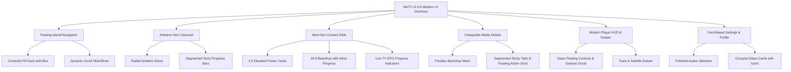

# NisTV Revamped v2.0.0 — Modern UI Overhaul Plan

## Executive Summary
This document outlines the strategic and architectural plan to deliver a next-generation **Modern UI** for NisTV Revamped while **preserving 100% of the signature brand colour palette** and existing design system tokens. Upon completion, the project will officially ship as **Version 2.0.0** (`VERSION_CODE=20000`).

---

## 1. Brand Color Palette (Preserved As-Is)

The visual identity and semantic tokens of NisTV Revamped ("Cinematic Obsidian") remain strictly anchored to the existing palette defined in [Color.kt](file:///data/data/com.termux/files/home/NisTV-Revamped/app/src/main/java/com/nis/nistv/core/designsystem/theme/Color.kt):

| Token Name | Hex Code | Visual Role |
| :--- | :--- | :--- |
| `NisBackground` | `#0B0D12` | Deep Obsidian Canvas / Base App Background |
| `NisSurface` | `#131823` | Primary Card & Surface Container |
| `NisSurfaceElevated` | `#1A2130` | Raised Containers, Dialogs, Filter Chips |
| `NisSurfaceHigh` | `#232C3F` | High-elevation overlays, popups, floating docks |
| `NisBorder` | `#2A3347` | Structural borders & separators |
| `NisBorderSubtle` | `#1E2536` | Subtle internal card dividers & hairpins |
| `NisAccentPrimary` | `#7A8FFF` | Electric Periwinkle: Primary action, focus rings, sliders |
| `NisAccentPrimaryPressed` | `#6377F0` | Pressed state feedback |
| `NisAccentCyan` | `#3CCBFF` | Streaming highlight, HD/4K badges, secondary accent |
| `NisAccentViolet` | `#A978FF` | Tertiary accent, brand gradient stop |
| `NisLiveRed` | `#FF4D5E` | Live TV indicator & pulsating dot |
| `NisAccentAmber` | `#F5A524` | TMDB star ratings & warning badges |
| `NisLiveEmerald` | `#34D399` | Online / Success indicator |
| `NisBrandGradient` | `[Cyan, Periwinkle, Violet]` | Hero glow, brand accent lines, active indicators |

All Design Guard constraints (`DesignGuardTest`, `ComponentDesignGuardTest`, `MotionDesignGuardTest`) will remain 100% green: zero unauthorized hardcoded hex colors, strict adherence to the 5-step `NisShapes` scale (`6dp`, `10dp`, `14dp`, `18dp`, `24dp`), and 48dp touch targets.

---

## 2. Core Pillars of the Modern UI 2.0.0 Overhaul

### Pillar 1: Floating Island Glass Bottom Navigation
- **Current State**: Edge-to-edge docked rectangular bar pinned to the bottom.
- **Modern 2.0 Design**:
  - **Centered Floating Pill Dock**: Floating above the bottom navigation bar inset (`NisPillShape` / `999dp`) with subtle border (`NisBorderSubtle`), ultra-crisp blurred glass background (`NisNavbarBg`), and soft drop shadow.
  - **Active State Glow**: Animated pill indicator sliding behind the active tab with soft periwinkle tint (`NisAccentPrimaryContainer`).
  - **Dynamic Scroll Hiding**: Seamlessly collapses on fast scroll down in Home and Discover to maximize viewing space for media posters and video playback; reappears instantly on scroll up.

### Pillar 2: Cinematic Hero Experience with Ambient Lighting
- **Current State**: Simple pager banner with basic dot indicators.
- **Modern 2.0 Design**:
  - **Dynamic Ambient Glow**: Soft radial background mesh (`NisBrandGradientSoft`) subtly illuminated by the dominant backdrop tones.
  - **Segmented Story Progress Bar**: Modern pill-shaped progress bars indicating carousel auto-advance timing.
  - **Glass Tag Pills**: Translucent chips for resolution (`4K UHD`, `1080p`), TMDB rating with star icon (`8.7`), and content genre.
  - **Dual Action CTAs**: Primary solid `NisPrimaryButton` ("Play Now") paired with an elegant glass-outlined `NisSecondaryButton` ("+ Watchlist" / "More Info").

### Pillar 3: Elevated Content Rails & Live TV Cards
- **Current State**: Standard rows with plain borders.
- **Modern 2.0 Design**:
  - **Poster Cards (2:3)**: Polished corner radius (`14dp` `NisMediaCardShape`), high-contrast metadata badges (HD, Season/Episode counts), and smooth tactile press springs (`NisPressable`).
  - **Continue Watching (16:9)**: Prominent episode thumbnail with glowing inline playback progress bar, timestamp badge ("42m left"), and quick "Resume" button.
  - **Live TV Rails**: Channel tiles featuring current EPG program title with live time progress bar, pulsating `NisLiveBadge`, and instant tap-to-player launch.

### Pillar 4: Immersive Media Details Screen
- **Current State**: Basic scrollable column with standard buttons.
- **Modern 2.0 Design**:
  - **Full-Bleed Parallax Header**: Collapsible backdrop image with smooth gradient fade into the obsidian canvas.
  - **Segmented Sticky Tabs**: "Overview", "Episodes & Seasons", "Cast & Crew" (circular avatar rail), and "More Like This".
  - **Floating Bottom Action Dock**: Sticky floating pill dock housing "Play / Resume", "Download" (with thread-count indicator), and "Add to List" for effortless one-handed reach.

### Pillar 5: Next-Gen Video Player HUD & Floating Drawer
- **Current State**: Standard media controls overlay.
- **Modern 2.0 Design**:
  - **Minimalist Floating Glass HUD**: Clean translucent control buttons with gesture scrub hints and time bubble preview.
  - **Quick Action Drawer**: Slide-up sheet for subtitle track selection, dual-audio switching, playback speed (0.5x - 2.0x), and PiP toggle.
  - **Mini-Player Modernization**: Floating card with subtle glow border, rounded corners (`18dp` `NisMiniPlayerShape`), and smooth swipe-to-dismiss.

### Pillar 6: Settings, Profile & Dialogs Modernization
- **Current State**: Plain list items in settings.
- **Modern 2.0 Design**:
  - **Grouped Glass Cards**: Neatly organized sections (Streaming & Playback, Downloads & Multi-Threading, Autopilot, Privacy, About) styled as elevated glass tiles with distinct leading icons.
  - **Profile Switcher Tile**: Prominent top profile card displaying the active avatar, Kids/Lock badges, and one-tap access to the "Who's Watching?" switcher.

---

## 3. Phased Implementation Roadmap

1. **Phase 1: Shell & Navigation**
   - Implement floating island glass bottom navigation bar with animated pill selector and scroll-collapse behavior.
   - Refine top app bars with consistent glass blur and quick-action icons.

2. **Phase 2: Home & Content Rails**
   - Refactor Hero carousel with ambient lighting, segmented progress indicators, and glass tag pills.
   - Upgrade `NisPosterMediaCard`, `NisBackdropMediaCard`, and `NisChannelCard` with modern badges and tactile press feedback.

3. **Phase 3: Media Details & Player Experience**
   - Enhance `MediaDetailsScreen` with full-bleed parallax backdrop, modern segmented tabs, and floating action dock.
   - Modernize Player HUD and slide-up audio/subtitle drawer.

4. **Phase 4: Profile, Downloads & Settings Hub**
   - Restyle `ProfileScreen` with grouped card sections and prominent active profile card.
   - Restyle `DownloadsScreen` cards to highlight multi-thread chunk speed and storage metrics.

5. **Phase 5: Release Verification & Version 2.0.0 Bump**
   - Run complete test suite (`./gradlew testDebugUnitTest --no-daemon`).
   - Run design guard tests (`DesignGuardTest`, `ComponentDesignGuardTest`, `MotionDesignGuardTest`).
   - Build debug APK (`./gradlew assembleDebug --no-daemon`).
   - Execute major version bump: `./gradlew bumpVersion -PbumpType=major -Pmessage="..."` resulting in `v2.0.0` (`VERSION_CODE=20000`).

---

## 4. Architectural Guarantees & Safety
- **No Regressions**: Player, live TV failover, multi-threaded downloads (OkHttp + NIO FileChannel), profiles, and AFDS auth remain completely untouched in their core logic.
- **Design Token Compliance**: Only tokens from `NisTheme` and `com.nis.nistv.core.designsystem.theme.*` will be used.
- **Accessibility**: 48dp minimum touch targets maintained; reduced-motion settings respected across all new transitions.
